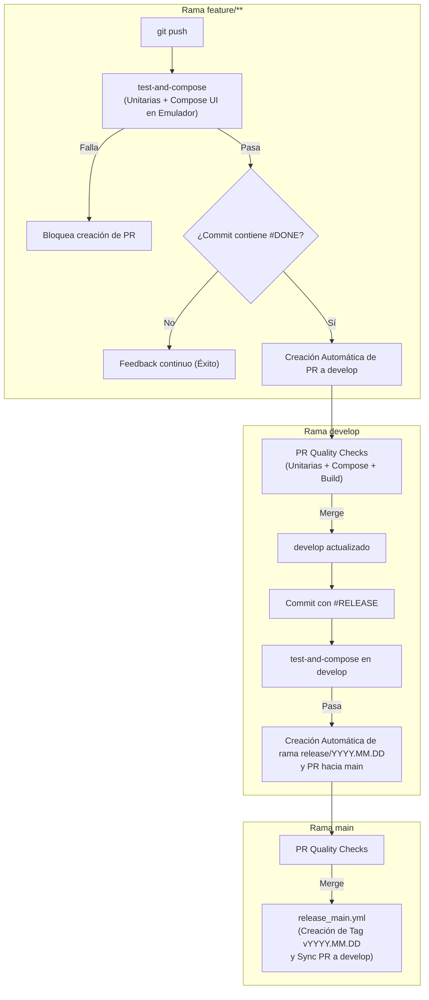

# Vinilos — Aplicación Móvil Android

## Descripción del Proyecto

**Vinilos** es una aplicación móvil para dispositivos Android desarrollada para **The Software Design Company (TSDC)** (Curso MISW4203). El objetivo principal del proyecto es llevar la funcionalidad de la aplicación web Vinilos al entorno móvil, aprovechando una API REST orientada a la gestión de álbumes, artistas, músicos y coleccionistas.

El principal reto consiste en replicar y adaptar las funcionalidades existentes teniendo en cuenta las restricciones de diseño de los dispositivos móviles, las políticas del sistema operativo Android y su modelo de programación reactiva.

Este proyecto se desarrolla como una aplicación nativa para Android, utilizando **Kotlin** y **Jetpack Compose**.

---

## Tecnologías y Stack Utilizado

- **Kotlin**: Lenguaje principal de programación.
- **Android SDK**: Herramientas y bibliotecas de desarrollo para Android (`minSdk 26`, `compileSdk 37`, `targetSdk 37`).
- **Jetpack Compose**: Toolkit declarativo moderno para la construcción de interfaces de usuario nativas.
- **Material 3**: Sistema de diseño y componentes visuales de Material Design.
- **Navigation Compose**: Gestión de navegación entre pantallas.
- **Gradle**: Sistema de automatización de compilación y gestión de dependencias (Gradle 9.x).
- **JDK 25**: Entorno Java requerido para ejecutar Gradle y el daemon de compilación (configurado en `gradle/gradle-daemon-jvm.properties`).
- **Frameworks de Pruebas**:
  - **JUnit 4**: Pruebas unitarias locales ejecutadas en la JVM del host.
  - **Jetpack Compose Testing (`androidx.compose.ui.test`)**: Pruebas de interfaz de usuario con APIs semánticas y reglas de prueba (`createComposeRule`).
- **API REST**: Servicio remoto para la consulta y gestión de datos de la aplicación.

---

## Estructura General del Proyecto

La estructura del repositorio sigue la organización estándar de proyectos Android modernos con Gradle:

```text
MISW4203-TSDC-Vinilos/
├── .github/
│   └── workflows/
│       ├── feature_develop.yml     # Flujo automático de Features con #DONE
│       ├── develop_release.yml     # Flujo automático de Releases con #RELEASE
│       ├── release_main.yml        # Flujo de cierre de release y tagging
│       └── pr_verification.yml     # Verificación de calidad en Pull Requests
├── app/
│   ├── src/
│   │   ├── main/
│   │   │   ├── java/com/example/misw4203_tsdc_vinilos/
│   │   │   │   ├── MainActivity.kt
│   │   │   │   ├── navigation/
│   │   │   │   ├── ui/
│   │   │   │   │   ├── components/
│   │   │   │   │   ├── screens/
│   │   │   │   │   └── theme/
│   │   │   │   ├── data/
│   │   │   │   └── model/
│   │   │   ├── res/
│   │   │   └── AndroidManifest.xml
│   │   ├── test/                   # Pruebas Unitarias (JVM / JUnit)
│   │   │   └── java/com/example/misw4203_tsdc_vinilos/
│   │   │       └── ExampleUnitTest.kt
│   │   └── androidTest/            # Pruebas de UI (Jetpack Compose Testing)
│   │       └── java/com/example/misw4203_tsdc_vinilos/
│   │           ├── ExampleInstrumentedTest.kt
│   │           └── GreetingComposeTest.kt
│   └── build.gradle.kts
├── gradle/
│   ├── wrapper/
│   └── gradle-daemon-jvm.properties
├── build.gradle.kts
├── settings.gradle.kts
├── gradle.properties
├── gradlew
├── gradlew.bat
└── README.md
```

### Descripción de Directorios y Paquetes

- **`MainActivity.kt`**: Punto de entrada principal de la aplicación Android que inicializa la interfaz de usuario con Jetpack Compose.
- **`navigation/`**: Configuración de rutas y navegación entre las diferentes pantallas de la aplicación.
- **`ui/components/`**: Componentes visuales reutilizables (tarjetas, botones, barras superiores, etc.).
- **`ui/screens/`**: Pantallas principales de la aplicación (álbumes, artistas, músicos, detalles, etc.).
- **`ui/theme/`**: Configuración de estilos visuales, colores, tipografía y temas de Material 3 (`Theme.kt`, `Color.kt`, `Type.kt`).
- **`data/`**: Capa de datos, clientes de red y repositorios encargados de consumir la API REST.
- **`model/`**: Clases de datos que representan las entidades del dominio (Álbum, Artista, Músico, etc.).
- **`res/`**: Recursos estáticos de Android (iconos, imágenes, cadenas de texto y temas XML).
- **`src/test/`**: Pruebas unitarias que se ejecutan localmente en la máquina de desarrollo sobre la JVM sin requerir emulador.
- **`src/androidTest/`**: Pruebas de interfaz de usuario de Jetpack Compose (`GreetingComposeTest`) que se ejecutan en un emulador Android.

---

## Requisitos Previos

Para desarrollar, compilar y ejecutar el proyecto localmente, asegúrese de contar con lo siguiente:

1. **Android Studio** (versión reciente recomendada).
2. **JDK 25** instalado y configurado en el sistema y en Android Studio para Gradle.
3. **Android SDK** con las plataformas y herramientas de compilación compatibles (API 37).
4. **Git** para el control de versiones.
5. Un **Emulador Android** configurado (AVD) o un dispositivo físico con depuración USB habilitada.

> **Nota:** El proyecto incluye Gradle Wrapper (`gradlew`) y el archivo `gradle/gradle-daemon-jvm.properties` configurado específicamente para utilizar **JDK 25**.

---

## Configuración y Puesta en Marcha

### 1. Clonar el Repositorio

Abra su terminal y ejecute los siguientes comandos para clonar el repositorio y acceder al directorio del proyecto:

```bash
git clone https://github.com/sdserranoa/MISW4203-TSDC-Vinilos.git
cd MISW4203-TSDC-Vinilos
```

### 2. Verificar la Versión de Java (JDK 25)

Asegúrese de tener configurado JDK 25 en su equipo:

```bash
java -version
```

Para comprobar la versión de la JVM utilizada por Gradle al compilar:

- **En Windows (PowerShell / CMD):**
  ```powershell
  .\gradlew.bat --version
  ```
- **En macOS / Linux:**
  ```bash
  ./gradlew --version
  ```
La salida debe indicar que la JVM de Gradle corresponde a **Java 25**.

### 3. Abrir el Proyecto en Android Studio

1. Inicie **Android Studio**.
2. Seleccione **Open** (Abrir proyecto existente).
3. Elija la carpeta raíz del repositorio (`MISW4203-TSDC-Vinilos`).
4. Espere a que Android Studio importe el proyecto y sincronice las dependencias de Gradle utilizando JDK 25.
5. Si se le solicita instalar componentes adicionales del SDK, acepte la instalación.

### 4. Compilación desde la Terminal

Si prefiere utilizar la línea de comandos, puede verificar la compilación ejecutando:

- **En Windows (PowerShell / CMD):**
  ```powershell
  .\gradlew.bat assembleDebug
  ```
- **En macOS / Linux:**
  ```bash
  ./gradlew assembleDebug
  ```

---

## Ejecución de Pruebas

El proyecto cuenta con dos suites de pruebas automatizadas:

### 1. Pruebas Unitarias (Locales / JVM)
Se ejecutan sobre la JVM del equipo sin necesidad de emulador. Se ubican en `app/src/test/`.

- **En Windows:**
  ```powershell
  .\gradlew.bat testDebugUnitTest
  ```
- **En macOS / Linux:**
  ```bash
  ./gradlew testDebugUnitTest
  ```
*Los reportes de resultados se generan en: `app/build/reports/tests/testDebugUnitTest/index.html`.*

### 2. Pruebas de Interfaz de Usuario (Jetpack Compose Testing)
Se ejecutan sobre un emulador Android encendido o dispositivo conectado. Se ubican en `app/src/androidTest/` (ej. [`GreetingComposeTest.kt`](app/src/androidTest/java/com/example/misw4203_tsdc_vinilos/GreetingComposeTest.kt)).

- **En Windows:**
  ```powershell
  .\gradlew.bat connectedAndroidTest
  ```
- **En macOS / Linux:**
  ```bash
  ./gradlew connectedAndroidTest
  ```
*Los reportes de resultados se generan en: `app/build/reports/androidTests/connected/index.html`.*

---

## Ejecución de la Aplicación

### Opción A: Desde Android Studio
1. Conecte un dispositivo físico con depuración USB o inicie un emulador virtual desde el **Device Manager**.
2. Asegúrese de que la configuración de ejecución seleccionada en la barra superior sea **`app`**.
3. Haga clic en el botón **Run ▶** (o presione `Shift + F10`).

### Opción B: Instalación directa mediante ADB
Una vez compilado el APK de depuración, puede instalarlo directamente en un dispositivo conectado ejecutando:

```bash
adb install -r app/build/outputs/apk/debug/app-debug.apk
```

---

## Integración Continua (CI/CD) — Pipelines de GitHub Actions

El repositorio cuenta con flujos de integración continua completamente automatizados para validar la calidad del código, ejecutar pruebas y gestionar el ciclo de vida de las ramas según la estrategia GitFlow:



### 1. Flujo de Features (`feature_develop.yml`)
- **Disparador**: Cada `push` a cualquier rama que comience con `feature/**`.
- **Job de Calidad (`test-and-compose`)**:
  - Configura **JDK 25** y Gradle con caché.
  - Ejecuta pruebas unitarias: `./gradlew testDebugUnitTest --continue`.
  - Inicia un emulador Android con aceleración por hardware (KVM) y ejecuta las pruebas de UI de Jetpack Compose: `./gradlew connectedAndroidTest`.
  - Publica los reportes de pruebas unitarias y de Compose como artefactos descargables del workflow.
  - **Bloqueo de seguridad**: Si alguna prueba unitaria o de Compose falla, el flujo se detiene inmediatamente.
- **Job de Apertura de PR (`create-pull-request`)**:
  - Requiere que el job de pruebas haya sido exitoso.
  - Si el último mensaje de commit incluye la etiqueta **`#DONE`**, crea automáticamente un Pull Request desde la rama de feature hacia `develop`.

### 2. Flujo de Release (`develop_release.yml`)
- **Disparador**: Cada `push` a la rama `develop`.
- **Validación de Calidad**: Ejecuta las pruebas unitarias y de Compose en `develop`.
- **Corte de Release**: Si las pruebas pasan y el commit incluye la etiqueta **`#RELEASE`**:
  - Genera automáticamente una nueva rama de versión (`release/YYYY.MM.DD`).
  - Sube la rama y crea el Pull Request de release hacia la rama `main`.

### 3. Verificación de Pull Requests (`pr_verification.yml`)
- **Disparador**: Ante cualquier `pull_request` abierto hacia `develop`, `main` o ramas `release/**`.
- **Validación**:
  - Ejecuta pruebas unitarias (`testDebugUnitTest`).
  - Ejecuta pruebas de UI de Jetpack Compose en emulador (`connectedAndroidTest`).
  - Verifica la compilación completa del APK (`assembleDebug`).
- Actúa como **Status Check** directo en GitHub para habilitar políticas de protección de ramas (*Branch Protection Rules*).

### 4. Cierre de Release y Sincronización (`release_main.yml`)
- **Disparador**: Al cerrarse y fusionarse el Pull Request de release hacia `main`.
- Extrae la versión de la rama, crea el **Tag y Release oficial** en GitHub (ej. `v2026.10.21`) y abre un PR de sincronización de vuelta hacia `develop`.

---

### Guía para Desarrolladores: Cómo usar `#DONE`

1. **Crear la rama de funcionalidad a partir de `develop`:**
   ```bash
   git checkout develop
   git pull origin develop
   git checkout -b feature/HU01-listar-albumes
   ```

2. **Realizar commits incrementales de desarrollo (sin `#DONE`):**
   ```bash
   git commit -m "feat: Implementar modelo y servicio de álbumes"
   git push origin feature/HU01-listar-albumes
   ```
   *(El pipeline validará que las pruebas unitarias y de Compose pasen en cada push, sin abrir aún el Pull Request).*

3. **Finalizar la funcionalidad con la etiqueta `#DONE`:**
   Una vez implementada la funcionalidad junto con sus respectivas pruebas unitarias y de Compose:
   ```bash
   git commit -m "feat: Completar interfaz y pruebas de álbumes #DONE"
   git push origin feature/HU01-listar-albumes
   ```
   *(El pipeline ejecutará la suite completa y, al aprobarla, creará automáticamente el Pull Request hacia `develop`).*

---

## Contribución y Buenas Prácticas

- Mantenga una estructura limpia y modular siguiendo los principios de arquitectura recomendados por Android (MVVM / Capas).
- Escriba pruebas unitarias para ViewModels y repositorios en `app/src/test/`.
- Escriba pruebas de interfaz con Jetpack Compose Testing en `app/src/androidTest/`.
- Valide que el proyecto compile y que los tests pasen localmente antes de realizar un `push` o crear un Pull Request.
- Asegúrese de no versionar archivos locales (`local.properties`, credenciales de firma, cachés de IDE, etc.).
