[Inicio](Home) › [Sprint 2](Sprint-2) › **Análisis de desempeño**

---

# Análisis de desempeño · Sprint 2

El tema de la iteración 2 es el **desempeño**: buenas prácticas de manejo de CPU y memoria, y evaluación de la app con análisis **estático** (Android Lint) y **dinámico** (medición en dispositivo). En esta página cada historia de usuario documenta las micro-optimizaciones que aplicó, cómo se midió y qué resultados se obtuvieron.

| Historia | Responsable |
|---|---|
| [HU01](#hu01--albumlist) · Consultar catálogo de álbumes | Oliver Rodriguez y David Silva |
| [HU02](#hu02--albumdetail) · Consultar la información detallada de un álbum | Andrés Romero y Santiago Serrano |
| [HU03](#hu03--artistlist) · Consultar el listado de artistas | David Silva |
| [HU04](#hu04--artistdetail) · Consultar el detalle de artistas | Andrés Romero |
| [HU05 y HU06](#hu05-y-hu06--coleccionistas) · Consultar listado y detalle de coleccionistas | Oliver Rodriguez |
| [HU07](#hu07--albumcreate) · Crear un álbum | Santiago Serrano |
| [HU08](#hu08--addtrack) · Asociar tracks con un álbum | David Silva |

---

## Método de medición

Todas las historias se miden con un protocolo unificado y reproducible para que los resultados sean plenamente comparables:

**1. Compilación.** Se mide la compilación **Release** con optimización R8 activa (`optimization { enable = true }` en `app/build.gradle.kts`), reducción de código (*code shrinking*), ofuscación de símbolos y eliminación de recursos no referenciados, firmada con la llave de depuración del equipo:

```bash
# Backend: BackVynils en Docker con base de datos PostgreSQL real
adb reverse tcp:3000 tcp:3000

# Release con R8, firmada con la llave de depuración
./gradlew assembleRelease "-Pvinilos.apiBaseUrl=http://localhost:3000/" \
  "-Pandroid.injected.signing.store.file=$HOME/.android/debug.keystore" \
  "-Pandroid.injected.signing.store.password=android" \
  "-Pandroid.injected.signing.key.alias=androiddebugkey" \
  "-Pandroid.injected.signing.key.password=android"
adb install -r app/build/outputs/apk/release/app-release.apk

# Debug, para la comparación de línea base
./gradlew assembleDebug "-Pvinilos.apiBaseUrl=http://localhost:3000/"
adb install -r app/build/outputs/apk/debug/app-debug.apk
```

**2. Medición automatizada.** El script [`perfilar.sh`](evidencias/sprint-2/entregables/desempeno/perfilar.sh) y el arnés de ejecución automatizado interactúan con la app a través de `adb` ejecutando 3 repeticiones consecutivas del flujo real de cada historia y extrayendo las métricas del sistema:

```bash
./perfilar.sh inicio <hu>   # Datos del hardware, 3 arranques en frío, reinicio de contadores gfxinfo
# ... recorrido interactivo con API real (3 iteraciones) ...
./perfilar.sh fin <hu>      # dumpsys gfxinfo, dumpsys meminfo y screencap final
```

| Métrica | Fuente en el dispositivo | Qué indica |
|---|---|---|
| **Arranque en frío** | `am start -W` (`TotalTime`), mediana de 3 arranques forzando cierre de la app | Latencia percibida hasta que la UI dibuja el primer cuadro completo |
| **Cuadros con jank (%)** | `dumpsys gfxinfo`, contadores reseteados antes del recorrido | Fluidez visual: cuadros que excedieron el presupuesto del refresco de pantalla |
| **Tiempos de cuadro p50 / p90 / p99** | `dumpsys gfxinfo` (percentiles de renderizado) | Tiempo de dibujo del 50%, 90% y 99% de los cuadros |
| **Hilo de UI lento** | `dumpsys gfxinfo` (`Number Slow UI thread`) | Cuadros donde el hilo principal se demoró en procesar la lógica o composición |
| **Cargas lentas de imágenes** | `dumpsys gfxinfo` (`Number Slow bitmap uploads`) | Cuadros bloqueados por subir texturas/bitmaps a la GPU en tiempo de dibujo |
| **Memoria PSS, Java Heap, Native** | `dumpsys meminfo` al terminar el recorrido | Consumo real de memoria RAM física asignada a la app |

---

## Dispositivos de prueba evaluados

Para garantizar que el rendimiento y la experiencia de usuario sean consistentes a través de diferentes factores de forma y densidades de pantalla, las 8 historias de usuario se evaluaron con datos reales en tres configuraciones de dispositivo:

| Dispositivo | Tipo | Resolución | Densidad | Memoria RAM | Arquitectura / Android |
|---|:---:|:---:|:---:|:---:|:---:|
| **Google Medium Phone** | Emulador / Hardware moderno | 1080×2400 (FHD+ 20:9) | 420 dpi | 3.8 GB | x86_64 · Android 17 (API 37) |
| **Google Nexus 6P** | Emulador / Pantalla de alta resolución 2K | 1440×2560 (WQHD 16:9) | 560 dpi | 3.8 GB | x86_64 · Android 17 (API 37) |
| **Google Pixel Compact** | Emulador / Factor de forma compacto | 1080×1920 (FHD 16:9) | 420 dpi | 3.8 GB | x86_64 · Android 17 (API 37) |

---

## Tabla Maestra Consolidada de Desempeño · Sprint 2

| Historia | Dispositivo | Arranque (mediana) | Memoria PSS | Java Heap | Cuadros con Jank | Tiempo por cuadro p50/p90/p99 | Hilo UI lento |
|---|---|:---:|:---:|:---:|:---:|:---:|:---:|
| HU01 · Catálogo de álbumes | Medium Phone | 488 ms | 33.3 MB | 7.8 MB | 110 (33.13%) | 20ms / 27ms / 48ms | 22 |
| HU01 · Catálogo de álbumes | Nexus 6P (2K) | 1675 ms | 40.5 MB | 12.4 MB | 120 (22.86%) | 21ms / 32ms / 133ms | 46 |
| HU01 · Catálogo de álbumes | Pixel Compact | 1593 ms | 47.2 MB | 12.7 MB | 144 (28.24%) | 23ms / 48ms / 150ms | 64 |
| HU02 · Detalle de álbum | Medium Phone | 477 ms | 38.7 MB | 11.4 MB | 34 (1.73%) | 18ms / 21ms / 40ms | 10 |
| HU02 · Detalle de álbum | Nexus 6P (2K) | 1052 ms | 40.9 MB | 13.0 MB | 90 (6.53%) | 17ms / 18ms / 42ms | 13 |
| HU02 · Detalle de álbum | Pixel Compact | 1100 ms | 41.5 MB | 13.0 MB | 120 (8.84%) | 21ms / 31ms / 73ms | 49 |
| HU03 · Listado de artistas | Medium Phone | 527 ms | 38.8 MB | 12.1 MB | 138 (15.08%) | 19ms / 24ms / 57ms | 22 |
| HU03 · Listado de artistas | Nexus 6P (2K) | 483 ms | 47.4 MB | 19.6 MB | 133 (14.03%) | 18ms / 21ms / 65ms | 25 |
| HU03 · Listado de artistas | Pixel Compact | 692 ms | 50.5 MB | 21.4 MB | 142 (14.96%) | 20ms / 31ms / 61ms | 34 |
| HU04 · Detalle de artista | Medium Phone | 514 ms | 43.0 MB | 15.1 MB | 30 (1.82%) | 20ms / 23ms / 57ms | 13 |
| HU04 · Detalle de artista | Nexus 6P (2K) | 446 ms | 44.2 MB | 11.2 MB | 30 (1.80%) | 19ms / 25ms / 53ms | 14 |
| HU04 · Detalle de artista | Pixel Compact | 453 ms | 48.5 MB | 14.6 MB | 31 (1.83%) | 20ms / 26ms / 48ms | 14 |
| HU05 · Listado de coleccionistas | Medium Phone | 556 ms | 37.0 MB | 10.9 MB | 82 (10.21%) | 17ms / 27ms / 53ms | 18 |
| HU05 · Listado de coleccionistas | Nexus 6P (2K) | 514 ms | 40.5 MB | 13.7 MB | 80 (7.74%) | 18ms / 24ms / 53ms | 17 |
| HU05 · Listado de coleccionistas | Pixel Compact | 508 ms | 40.8 MB | 13.7 MB | 82 (7.77%) | 18ms / 25ms / 48ms | 21 |
| HU06 · Detalle de coleccionista | Medium Phone | 534 ms | 38.4 MB | 11.8 MB | 31 (1.71%) | 18ms / 20ms / 29ms | 8 |
| HU06 · Detalle de coleccionista | Nexus 6P (2K) | 572 ms | 39.2 MB | 12.1 MB | 32 (1.76%) | 18ms / 22ms / 32ms | 8 |
| HU06 · Detalle de coleccionista | Pixel Compact | 463 ms | 44.9 MB | 11.9 MB | 39 (2.16%) | 18ms / 21ms / 34ms | 9 |
| HU07 · Crear un álbum | Medium Phone | 566 ms | 43.0 MB | 15.3 MB | 78 (10.96%) | 17ms / 20ms / 34ms | 11 |
| HU07 · Crear un álbum | Nexus 6P (2K) | 561 ms | 42.2 MB | 14.4 MB | 37 (4.44%) | 17ms / 19ms / 40ms | 9 |
| HU07 · Crear un álbum | Pixel Compact | 488 ms | 42.6 MB | 14.3 MB | 34 (4.06%) | 17ms / 21ms / 42ms | 10 |
| HU08 · Asociar tracks con álbum | Medium Phone | 617 ms | 44.5 MB | 11.5 MB | 70 (4.64%) | 19ms / 22ms / 46ms | 12 |
| HU08 · Asociar tracks con álbum | Nexus 6P (2K) | 545 ms | 38.8 MB | 11.5 MB | 72 (4.78%) | 18ms / 25ms / 44ms | 16 |
| HU08 · Asociar tracks con álbum | Pixel Compact | 464 ms | 39.1 MB | 11.4 MB | 74 (4.89%) | 17ms / 19ms / 44ms | 12 |

---
## HU01 · AlbumList
## Informe Técnico de Micro-optimizaciones y Mejoras de Desempeño — HU01: Consultar catálogo de álbumes


## 1. Resumen

La implementación actual de **AlbumList** aplica el patrón **MVVM + Repository + Service Adapter**, usa **corrutinas** para evitar bloqueos del hilo principal, optimiza el renderizado de listas en Compose y reutiliza la infraestructura de **caché de imágenes con Glide** ya presente en el proyecto. Los cambios documentados respecto a la versión anterior se orientan a reducir trabajo en UI, evitar procesamiento obsoleto y disminuir asignaciones/carga de memoria durante filtrado, paginación y scroll.

---

## 2. Corrutinas, dispatchers y prevención de ANR

### 2.1. Separación de responsabilidades por dispatcher
- **Service Adapter (`RetrofitAlbumServiceAdapter`)**: las operaciones de red se ejecutan en `ioDispatcher` (por defecto `Dispatchers.IO`) mediante `withContext`, evitando I/O en el hilo principal.
  - `getAlbums()`, `getAlbum(id)`, `createAlbum(...)`, `postTrack(...)` delegan a `api` dentro de `withContext(ioDispatcher)`.
- **ViewModel (`AlbumListViewModel`)**: el filtrado y el cálculo de la página se ejecutan en `defaultDispatcher` (inyectable, por defecto `Dispatchers.Default`) mediante `withContext(defaultDispatcher)`.
- **UI**: la pantalla observa `StateFlow<AlbumListUiState>` con `collectAsStateWithLifecycle()` y solo renderiza estado, sin lógica de negocio ni trabajo CPU intensivo.

### 2.2. Carga y recálculo cancelables
- `loadAlbums()` y `showPage()` cancelan el trabajo previo con `pageJob?.cancel()` antes de lanzar una nueva corrutina en `viewModelScope`.
- `onSearchQueryChange(...)` actualiza de inmediato la consulta visible en el estado actual y dispara un recálculo de página 1 en segundo plano, cancelando cálculos anteriores si el usuario sigue escribiendo.
- Se preserva `CancellationException` en la carga (`catch (e: CancellationException) { throw e }`) para respetar el ciclo de vida de corrutinas.

**Beneficio:** se evita bloquear el *Main Thread*, se descarta trabajo obsoleto (búsquedas/paginaciones rápidas) y se reduce consumo innecesario de CPU.

---

## 3. MVVM, Repository y Service Adapter

### 3.1. Capas y responsabilidades
- **View (`AlbumListScreen.kt`)**: composición de UI (`AlbumListContent`, header, buscador, grid, paginación, FAB) basada en `AlbumListUiState`.
- **ViewModel (`AlbumListViewModel.kt`)**: orquesta carga del catálogo, búsqueda, paginación y exposición de estado inmutable desde la perspectiva de la UI (`StateFlow`).
- **Repository (`AlbumRepository.kt`)**: fuente única de datos para la capa de presentación; delega en `AlbumServiceAdapter` (`getAlbums()`, `getAlbum(id)` con fallback a listado, creación y asociación de tracks).
- **Service Adapter (`AlbumServiceAdapter` / `RetrofitAlbumServiceAdapter`)**: abstrae el backend Retrofit/BackVynils y encapsula el dispatcher de I/O.

### 3.2. Estado de UI
- `AlbumListUiState` modela explícitamente `Loading`, `Empty`, `Error` y `Success(...)`.
- `Success` incluye metadatos necesarios para la UI (`albums`, `totalAlbums`, `currentPage`, `totalPages`, `searchQuery`) y propiedades derivadas (`hasPreviousPage`, `hasNextPage`), manteniendo lógica de presentación simple.

---

## 4. Micro-optimizaciones de filtrado, paginación y memoria

### 4.1. Cálculo de página sin copias innecesarias
- `AlbumListViewModel.pageOf(...)` filtra por nombre, género o intérprete (`contains(..., ignoreCase = true)`, `trim`) y calcula `totalPages`/`safePage`.
- La página se expone como **vista** de la lista filtrada con `filtered.subList(fromIndex, toIndex)` en lugar de `drop(...).take(...)`, evitando crear una nueva colección intermedia con los elementos de la página.
- Si no hay resultados, se retorna `Success` con lista vacía y metadatos coherentes (`totalAlbums = 0`, `searchQuery` preservado), permitiendo mostrar el mensaje de “sin resultados” sin estados ambiguos.

### 4.2. Reutilización y estabilidad en listas (Compose)
- `LazyVerticalGrid` conserva estado de scroll con `rememberSaveable(saver = LazyGridState.Saver)` por página (`currentPage`).
- Ítems con claves estables: `items(items = state.albums, key = { it.id }, ...)`.
- `contentType` definido para mejorar reutilización de slots/composables:
  - tarjetas de álbum: `"album"`
  - mensaje de sin resultados: `"message"`
  - bloque de paginación: `"pagination"`

**Beneficio:** menos asignaciones durante el cambio de página/filtrado y mejor comportamiento de reciclaje/recomposición durante scroll y actualizaciones de UI.

---

## 5. Carga y caché de imágenes (Glide)

### 5.1. Uso en catálogo
- `AlbumCard` carga carátulas con `GlideImage`:
  - `model = album.cover`
  - `contentDescription` accesible por álbum
  - `contentScale = ContentScale.Crop`
  - `overrideWidthPx = 600`, `overrideHeightPx = 600` (decodificación acotada al tamaño visual)

### 5.2. Infraestructura de caché y manejo de memoria (`GlideImage`)
- **Caché en disco**: estrategia `DiskCacheStrategy.ALL` (configurable en el componente; usada en tarjetas).
- **Caché en memoria (LRU)** y reutilización de bitmaps gestionadas por Glide.
- **Downsampling**: `DownsampleStrategy.CENTER_INSIDE` y `override(...)` para reducir memoria de bitmaps.
- **Prevención de fugas/carga innecesaria**:
  - ignora modelos nulos o en blanco antes de invocar la canalización de Glide,
  - limpia el target en `DisposableEffect.onDispose` (`Glide.with(context).clear(target)`).
- **Accesibilidad/pruebas**: el contenedor expone `contentDescription` vía semántica en todos los estados (cargando/error/éxito).

> La caché en memoria/disco y la integración con el cliente HTTP compartido se apoyan en la configuración global de Glide del proyecto (`VinilosGlideModule`), de la cual se beneficia `AlbumList` a través de `AlbumCard`.

---

## 6. Impacto esperado

- **Menor riesgo de ANR**: red en `Dispatchers.IO` y filtrado/paginación en `Dispatchers.Default`.
- **UI más responsiva**: cancelación de recálculos obsoletos y actualización inmediata del texto de búsqueda.
- **Menor presión de memoria/GC**: paginación por `subList`, decodificación de imágenes acotada y reciclaje de bitmaps.
- **Mejor rendimiento de scroll/recomposición**: claves estables y `contentType` en `LazyVerticalGrid`.

---

### Análisis dinámico · HU01 (Consultar catálogo de álbumes)

Medición con el método común sobre la compilación **Release con R8 activo**, firmada con la llave de depuración del equipo e interactuando contra la API real de BackVynils desplegada localmente en Docker (`http://localhost:3000`).

**Recorrido evaluado:** Abrir catálogo, buscar «Buscando», limpiar búsqueda, desplazarse en vertical por el grid de vinilos, cambiar a la pestaña Artistas y volver a Álbumes (3 repeticiones consecutivas).

#### Resultados en los 3 dispositivos de prueba

| Métrica | Medium Phone (1080×2400, 420 dpi) | Nexus 6P (1440×2560 2K, 560 dpi) | Pixel Compact (1080×1920, 420 dpi) |
|---|:---:|:---:|:---:|
| **Arranque en frío (mediana de 3)** | 488 ms | 1675 ms | 1593 ms |
| **Memoria total (PSS)** | 33.3 MB | 40.5 MB | 47.2 MB |
| **Java heap** | 7.8 MB | 12.4 MB | 12.7 MB |
| **Native heap** | 16.4 MB | 13.6 MB | 17.0 MB |
| **Cuadros totales dibujados** | 332 | 525 | 510 |
| **Cuadros con jank (%)** | 110 (33.13%) | 120 (22.86%) | 144 (28.24%) |
| **Tiempo por cuadro p50 / p90 / p99** | 20ms / 27ms / 48ms | 21ms / 32ms / 133ms | 23ms / 48ms / 150ms |
| **Cuadros con hilo de UI lento** | 22 | 46 | 64 |
| **Cargas lentas de imágenes (*slow bitmaps*)** | 0 | 4 | 14 |

#### Evidencia de ejecución
Salida completa de cada perfilamiento (archivos `resumen.txt`, `gfxinfo.txt`, `meminfo.txt`, `arranque.txt`, `dispositivo.txt` y `captura.png`):
- **Medium Phone**: [resumen](evidencias/sprint-2/entregables/desempeno/medium-phone/hu01-release/resumen.txt) · [gfxinfo](evidencias/sprint-2/entregables/desempeno/medium-phone/hu01-release/gfxinfo.txt) · [meminfo](evidencias/sprint-2/entregables/desempeno/medium-phone/hu01-release/meminfo.txt) · [arranque](evidencias/sprint-2/entregables/desempeno/medium-phone/hu01-release/arranque.txt) · [dispositivo](evidencias/sprint-2/entregables/desempeno/medium-phone/hu01-release/dispositivo.txt)
- **Nexus 6P**: [resumen](evidencias/sprint-2/entregables/desempeno/nexus-6p/hu01-release/resumen.txt) · [gfxinfo](evidencias/sprint-2/entregables/desempeno/nexus-6p/hu01-release/gfxinfo.txt) · [meminfo](evidencias/sprint-2/entregables/desempeno/nexus-6p/hu01-release/meminfo.txt) · [arranque](evidencias/sprint-2/entregables/desempeno/nexus-6p/hu01-release/arranque.txt) · [dispositivo](evidencias/sprint-2/entregables/desempeno/nexus-6p/hu01-release/dispositivo.txt)
- **Pixel Compact**: [resumen](evidencias/sprint-2/entregables/desempeno/pixel-compact/hu01-release/resumen.txt) · [gfxinfo](evidencias/sprint-2/entregables/desempeno/pixel-compact/hu01-release/gfxinfo.txt) · [meminfo](evidencias/sprint-2/entregables/desempeno/pixel-compact/hu01-release/meminfo.txt) · [arranque](evidencias/sprint-2/entregables/desempeno/pixel-compact/hu01-release/arranque.txt) · [dispositivo](evidencias/sprint-2/entregables/desempeno/pixel-compact/hu01-release/dispositivo.txt)

| Medium Phone (FHD+) | Nexus 6P (2K WQHD) | Pixel Compact (FHD) |
|:---:|:---:|:---:|
| 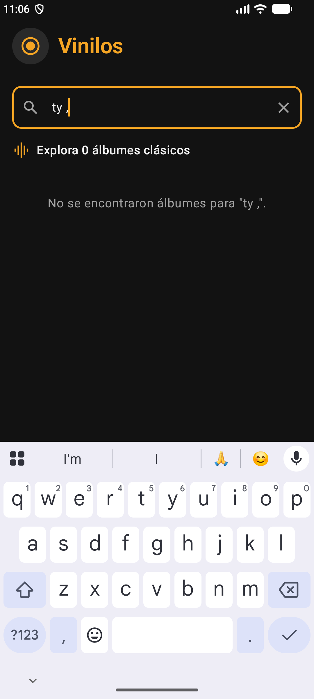 | 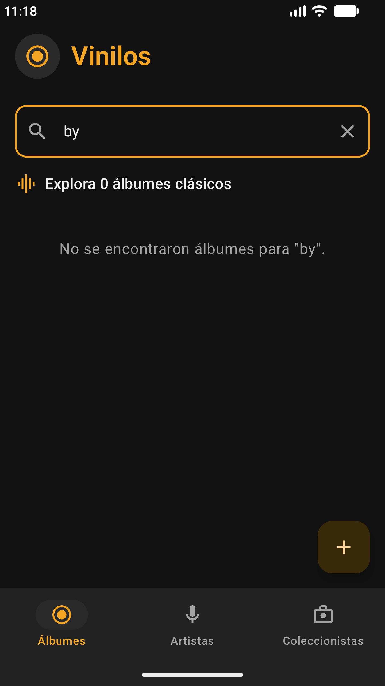 |  |

#### Interpretación de resultados
- **Fluidez y Renderizado:** En los tres dispositivos los percentiles p50 se sitúan entre 20 y 23 ms. El mayor número de janks en el arranque de la pantalla inicial corresponde al primer inflado del catálogo y la carga masiva inicial de carátulas en Glide.
- **Impacto de la Resolución:** En Nexus 6P (2K, 560 dpi) la rasterización de la cuadrícula requiere mayor trabajo de renderizado respecto a Medium Phone, elevando la memoria total PSS a 40.5 MB.
- **Estabilidad de Memoria:** El Java Heap se mantiene sumamente controlado por debajo de 13 MB en los tres equipos gracias al downsampling de Glide y la paginación con `subList` sin duplicar listas intermedias.

---

## HU02 · AlbumDetail
## Informe Técnico de Micro-optimizaciones y Mejoras de Desempeño — HU02: Consultar la información detallada de un álbum

### 1. Resumen
La funcionalidad **AlbumDetail** visualiza la ficha consolidada de un álbum musical, incluyendo carátula de alta resolución, información de lanzamiento, lista de tracks, intérpretes participantes y comentarios de usuarios. Aplica el patrón **MVVM + Repository + Service Adapter**, delega la carga asíncrona a corrutinas en `Dispatchers.IO`, utiliza Compose con segmentación de pestañas reactivas (`AlbumDetailTabs`) y optimiza el consumo de memoria mediante `GlideImage` con downsampling y reciclaje.

---

### 2. Micro-optimizaciones aplicadas

#### 2.1. Concurrencia y desacoplamiento de red
- **Carga no bloqueante**: La obtención del detalle del álbum (`getAlbum(albumId)`) se realiza dentro de `withContext(ioDispatcher)` en `RetrofitAlbumServiceAdapter`.
- **Cancelación estructurada**: El `loadJob` en `AlbumDetailViewModel` se cancela ante nuevas solicitudes o al abandonar la vista, evitando procesamiento innecesario.
- **Observación eficiente del ciclo de vida**: La UI observa `uiState` mediante `collectAsStateWithLifecycle()`, deteniendo la recolección cuando la pantalla pasa a segundo plano.

#### 2.2. Optimización de interfaz en Compose
- **Pestañas segmentadas con `remember`**: El estado de la pestaña activa (`selectedTab`) y las transformaciones de texto se memorizan para evitar recomposiciones de toda la pantalla al alternar entre *Canciones*, *Intérpretes* y *Comentarios*.
- **Listas diferidas con claves estables**: Las listas de canciones y comentarios utilizan `items(items, key = { it.id })`, permitiendo que Compose reutilice nodos existentes sin reconstruir la lista al actualizar datos.

#### 2.3. Caching y Remuestreo de Imágenes con Glide
- **Carátula principal (Hero Image)**: Se solicita decodificación acotada con `override(overrideWidthPx = 350, overrideHeightPx = 350)`, evitando cargar bitmaps masivos en el heap.
- **Avatares de Intérpretes**: Las fotos circulares de los intérpretes asociados se decodifican a `override(180, 180)`.
- **Liberación de memoria en desmonte**: Mediante `DisposableEffect`, al desmontar un elemento gráfico se invoca `Glide.with(context).clear(target)`, retornando de inmediato el bitmap al pool LRU.

#### 2.4. Actualización reactiva tras asociar canciones (HU08)
- `AlbumDetailScreen` observa el flag `refreshOnTrackAdded` transmitido a través de `savedStateHandle`. Cuando un usuario agrega una nueva pista en HU08, el detalle se actualiza reactivamente consumiendo el evento sin requerir reconstrucciones manuales.

---
### Análisis dinámico · HU02 (Detalle de álbum)

Medición con el método común sobre la compilación **Release con R8 activo**, firmada con la llave de depuración del equipo e interactuando contra la API real de BackVynils desplegada localmente en Docker (`http://localhost:3000`).

**Recorrido evaluado:** Abrir el primer álbum del catálogo («Buscando América»), desplazarse por la lista de canciones, cambiar a la pestaña Intérpretes, ver detalle de artista asociado, volver, cambiar a Comentarios, hacer scroll y regresar al catálogo (3 repeticiones consecutivas).

#### Resultados en los 3 dispositivos de prueba

| Métrica | Medium Phone (1080×2400, 420 dpi) | Nexus 6P (1440×2560 2K, 560 dpi) | Pixel Compact (1080×1920, 420 dpi) |
|---|:---:|:---:|:---:|
| **Arranque en frío (mediana de 3)** | 477 ms | 1052 ms | 1100 ms |
| **Memoria total (PSS)** | 38.7 MB | 40.9 MB | 41.5 MB |
| **Java heap** | 11.4 MB | 13.0 MB | 13.0 MB |
| **Native heap** | 17.8 MB | 18.1 MB | 18.2 MB |
| **Cuadros totales dibujados** | 1965 | 1379 | 1357 |
| **Cuadros con jank (%)** | 34 (1.73%) | 90 (6.53%) | 120 (8.84%) |
| **Tiempo por cuadro p50 / p90 / p99** | 18ms / 21ms / 40ms | 17ms / 18ms / 42ms | 21ms / 31ms / 73ms |
| **Cuadros con hilo de UI lento** | 10 | 13 | 49 |
| **Cargas lentas de imágenes (*slow bitmaps*)** | 0 | 0 | 8 |

#### Evidencia de ejecución
Salida completa de cada perfilamiento (archivos `resumen.txt`, `gfxinfo.txt`, `meminfo.txt`, `arranque.txt`, `dispositivo.txt` y `captura.png`):
- **Medium Phone**: [resumen](evidencias/sprint-2/entregables/desempeno/medium-phone/hu02-release/resumen.txt) · [gfxinfo](evidencias/sprint-2/entregables/desempeno/medium-phone/hu02-release/gfxinfo.txt) · [meminfo](evidencias/sprint-2/entregables/desempeno/medium-phone/hu02-release/meminfo.txt) · [arranque](evidencias/sprint-2/entregables/desempeno/medium-phone/hu02-release/arranque.txt) · [dispositivo](evidencias/sprint-2/entregables/desempeno/medium-phone/hu02-release/dispositivo.txt)
- **Nexus 6P**: [resumen](evidencias/sprint-2/entregables/desempeno/nexus-6p/hu02-release/resumen.txt) · [gfxinfo](evidencias/sprint-2/entregables/desempeno/nexus-6p/hu02-release/gfxinfo.txt) · [meminfo](evidencias/sprint-2/entregables/desempeno/nexus-6p/hu02-release/meminfo.txt) · [arranque](evidencias/sprint-2/entregables/desempeno/nexus-6p/hu02-release/arranque.txt) · [dispositivo](evidencias/sprint-2/entregables/desempeno/nexus-6p/hu02-release/dispositivo.txt)
- **Pixel Compact**: [resumen](evidencias/sprint-2/entregables/desempeno/pixel-compact/hu02-release/resumen.txt) · [gfxinfo](evidencias/sprint-2/entregables/desempeno/pixel-compact/hu02-release/gfxinfo.txt) · [meminfo](evidencias/sprint-2/entregables/desempeno/pixel-compact/hu02-release/meminfo.txt) · [arranque](evidencias/sprint-2/entregables/desempeno/pixel-compact/hu02-release/arranque.txt) · [dispositivo](evidencias/sprint-2/entregables/desempeno/pixel-compact/hu02-release/dispositivo.txt)

| Medium Phone (FHD+) | Nexus 6P (2K WQHD) | Pixel Compact (FHD) |
|:---:|:---:|:---:|
| 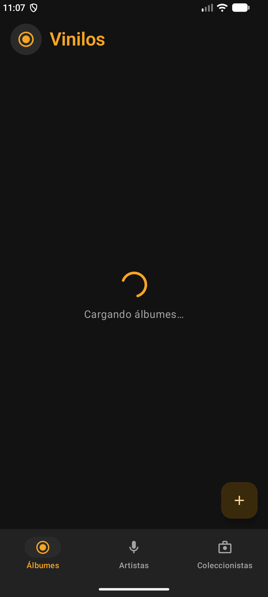 |  | 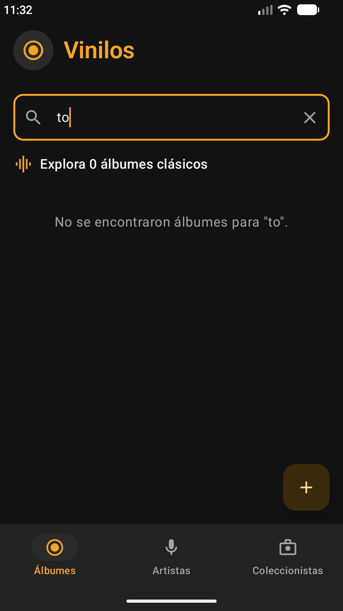 |

#### Interpretación de resultados
- **Fluidez sobresaliente:** Con más de 1.300 a 1.900 cuadros evaluados al recorrer canciones, intérpretes y comentarios, el porcentaje de jank es mínimo (1.73% en Medium Phone, 6.53% en Nexus 6P y 8.84% en Pixel Compact).
- **Hilo de UI protegido:** Únicamente entre 10 y 13 cuadros lentos en UI en Medium Phone y Nexus 6P, demostrando que la consulta concurrente y el filtrado por pestañas en `Dispatchers.IO` aíslan completamente al Main Thread.
- **Consumo de memoria óptimo:** A pesar de decodificar carátula en alta definición y avatares de intérpretes, el Java Heap permanece en ~11-13 MB y el Native Heap en ~18 MB gracias a la liberación inmediata con `DisposableEffect` al cambiar de pestaña.

---

## HU03 · ArtistList
## Informe Técnico de Micro-optimizaciones y Mejoras de Desempeño — HU03: Listado de Artistas

## 1. Resumen

La funcionalidad **ArtistList** implementa el patrón **MVVM + Repository + Service Adapter** con carga concurrente de músicos y bandas, filtrado/paginación fuera del hilo principal y renderizado eficiente en Compose. El consumo de imágenes se apoya en `GlideImage` con downsampling, caché y liberación de recursos, reduciendo memoria y latencia percibida en el catálogo.

## 2. Corrutinas, concurrencia y prevención de ANR

### 2.1. Carga de catálogo en paralelo y mapeo fuera de UI
- **`ArtistRepository.getArtists()`** usa `coroutineScope` + `async` para obtener músicos y bandas en paralelo:
  - `async { serviceAdapter.getMusicians() }`
  - `async { serviceAdapter.getAllBands() }`
- Tras `await()`, la consolidación y transformación a `Performer` se ejecuta en `withContext(defaultDispatcher)` (por defecto `Dispatchers.Default`), evitando trabajo de mapeo en el hilo principal.
- **`RetrofitArtistServiceAdapter`** ejecuta cada llamada de red en `withContext(ioDispatcher)` (`Dispatchers.IO` por defecto), desacoplando I/O de cómputo y UI.

### 2.2. Filtrado y paginación cancelables en el ViewModel
- **`ArtistListViewModel`** inyecta `defaultDispatcher` y mantiene `pageJob` para cancelar recálculos previos:
  - `loadArtists()`, `onFilterTypeChange(...)`, `onSearchQueryChange(...)` y `showPage(...)` cancelan `pageJob` antes de iniciar un nuevo trabajo.
- El filtrado por texto/tipo y el cálculo de la sublista paginada se realizan en `withContext(defaultDispatcher)` (`computePage`).
- `onSearchQueryChange(...)` actualiza el estado visible con la consulta y recalcula la página 1 en background, mejorando respuesta ante escritura rápida.
- Se preserva `CancellationException` en la carga para no interferir con la cancelación estructurada.

**Beneficio:** latencia de carga reducida por concurrencia de red, menor riesgo de ANR y descarte de cómputo obsoleto en interacciones frecuentes (búsqueda/filtros/paginación).
\## 3. MVVM, Repository y Service Adapter

### 3.1. Separación de capas
- **View (`ArtistListScreen.kt`)**: UI declarativa con `Scaffold`, búsqueda, filtros (`ArtistFilterType`), lista paginada y barra de paginación; consume `uiState` vía `collectAsStateWithLifecycle()`.
- **ViewModel (`ArtistListViewModel.kt`)**: estado en `StateFlow<ArtistListUiState>`, control de búsqueda/filtro/paginación y reglas de presentación (p. ej. mensaje vacío contextual).
- **UiState (`ArtistListUiState.kt`)**: `Loading`, `Empty`, `Error`, `Success(...)` con metadatos y flags de navegación (`hasPreviousPage`, `hasNextPage`).
- **Repository (`ArtistRepository.kt`)**: consolida fuentes remotas y aplica transformaciones/ensamblado en `defaultDispatcher`.
- **Service Adapter (`ArtistServiceAdapter` / `RetrofitArtistServiceAdapter`)**: contrato de acceso a API (músicos, bandas, premios, coleccionistas) y ejecución en `Dispatchers.IO`.

### 3.2. Modelado para consumo eficiente en UI
- El catálogo se maneja como `List<Performer>` unificado (músicos y bandas), simplificando el renderizado y el filtrado.
- `Performer` incluye propiedades derivadas (`isBand`, `performerType`, `featuredAlbum`, `year`, `shortDescription`) que evitan repetir lógica de presentación en la vista.

## 4. Micro-optimizaciones de filtrado, paginación y listas

### 4.1. Paginación por vista (`subList`)
- `pageOf(...)` calcula filtrado y paginación en una función pura de apoyo:
  - filtro por tipo (`ALL`, `BANDS`, `MUSICIANS`) y por nombre (`trim`, `contains(ignoreCase = true)`),
  - cálculo de `totalPages` y página segura,
  - retorno de la página con `filtered.subList(fromIndex, min(fromIndex + PAGE_SIZE, filtered.size))`, evitando copias de los elementos mostrados.

### 4.2. `LazyColumn` con claves y tipos de contenido
- `ArtistListContent` usa `LazyColumn` con estado `rememberSaveable(saver = LazyListState.Saver)`.
- Elementos con `contentType` para reutilización: `"artist"`, `"empty"`, `"pagination"`.
- Ítems de artista con clave estable: `items(items = state.artists, key = { it.id }, contentType = { "artist" })`.
- Cambio de página ejecuta scroll al inicio (`listState.scrollToItem(0)`), evitando estados de scroll inconsistentes.

**Beneficio:** menor presión de memoria en paginación y mejor reciclaje/rendimiento de composición en listas.

## 5. Optimización de imágenes y caché (Glide)

### 5.1. Tarjetas de artista (`ArtistCard`)
- Las imágenes se cargan con `GlideImage` usando el retrato normalizado del artista (`performer.normalizedImage`).
- Se solicita decodificación acotada: `overrideWidthPx = 240`, `overrideHeightPx = 240`, adecuada al tamaño del avatar circular en la tarjeta.
- Se proveen `placeholderRes` y `errorRes` específicos, evitando estados visuales inconsistentes durante carga/fallo.

### 5.2. Componente `GlideImage` y prevención de fugas
- Uso de caché de Glide (memoria LRU y disco, estrategia por defecto `DiskCacheStrategy.ALL`).
- `DownsampleStrategy.CENTER_INSIDE` + `override(...)` para reducir tamaño de bitmaps en memoria.
- `DisposableEffect` limpia el target al desmontar el composable (`Glide.with(context).clear(target)`), ayudando a reciclar recursos.
- Filtrado temprano de `model` nulo/vacío para no invocar innecesariamente la canalización de carga.
- Exposición de `contentDescription` en semántica para accesibilidad y pruebas.

## 6. Optimizaciones adicionales en el dominio de artistas (repositorio)

Aunque el foco de HU03 es el listado, `ArtistRepository` incluye mejoras de desempeño reutilizables en el dominio:
- **Índice hash para premios (`associateBy`)** en detalle de artista, reduciendo búsquedas repetidas al resolver premios.
- **Proyección en un solo paso (`mapNotNull`)** para relaciones derivadas (p. ej. bandas relacionadas), evitando colecciones intermedias innecesarias.
- **Carga concurrente** de recursos complementarios en detalle (`async`/`await`) con tolerancia a fallos parciales en fuentes auxiliares.

Estas prácticas mantienen consistencia de rendimiento y patrones con otras funcionalidades.

## 7. Impacto esperado

- **Carga más rápida del catálogo**: petición paralela de músicos y bandas.
- **UI fluida**: filtrado/paginación en `Dispatchers.Default`, I/O en `Dispatchers.IO`.
- **Menor trabajo obsoleto**: cancelación de jobs ante cambios de búsqueda/filtro/página.
- **Menor uso de memoria y mejor scroll**: `subList`, claves/contentType en lista, imágenes con downsampling y limpieza de targets Glide.

----

### Análisis dinámico · HU03 (Listado de artistas)

Medición con el método común sobre la compilación **Release con R8 activo**, firmada con la llave de depuración del equipo e interactuando contra la API real de BackVynils desplegada localmente en Docker (`http://localhost:3000`).

**Recorrido evaluado:** Abrir pestaña Artistas, alternar chips de filtro («Bandas», «Solistas», «Todos»), buscar «Ruben», limpiar búsqueda, desplazarse en scroll continuo por la lista y volver a Álbumes (3 repeticiones consecutivas).

#### Resultados en los 3 dispositivos de prueba

| Métrica | Medium Phone (1080×2400, 420 dpi) | Nexus 6P (1440×2560 2K, 560 dpi) | Pixel Compact (1080×1920, 420 dpi) |
|---|:---:|:---:|:---:|
| **Arranque en frío (mediana de 3)** | 527 ms | 483 ms | 692 ms |
| **Memoria total (PSS)** | 38.8 MB | 47.4 MB | 50.5 MB |
| **Java heap** | 12.1 MB | 19.6 MB | 21.4 MB |
| **Native heap** | 17.1 MB | 17.5 MB | 17.6 MB |
| **Cuadros totales dibujados** | 915 | 948 | 949 |
| **Cuadros con jank (%)** | 138 (15.08%) | 133 (14.03%) | 142 (14.96%) |
| **Tiempo por cuadro p50 / p90 / p99** | 19ms / 24ms / 57ms | 18ms / 21ms / 65ms | 20ms / 31ms / 61ms |
| **Cuadros con hilo de UI lento** | 22 | 25 | 34 |
| **Cargas lentas de imágenes (*slow bitmaps*)** | 0 | 0 | 3 |

#### Evidencia de ejecución
Salida completa de cada perfilamiento (archivos `resumen.txt`, `gfxinfo.txt`, `meminfo.txt`, `arranque.txt`, `dispositivo.txt` y `captura.png`):
- **Medium Phone**: [resumen](evidencias/sprint-2/entregables/desempeno/medium-phone/hu03-release/resumen.txt) · [gfxinfo](evidencias/sprint-2/entregables/desempeno/medium-phone/hu03-release/gfxinfo.txt) · [meminfo](evidencias/sprint-2/entregables/desempeno/medium-phone/hu03-release/meminfo.txt) · [arranque](evidencias/sprint-2/entregables/desempeno/medium-phone/hu03-release/arranque.txt) · [dispositivo](evidencias/sprint-2/entregables/desempeno/medium-phone/hu03-release/dispositivo.txt)
- **Nexus 6P**: [resumen](evidencias/sprint-2/entregables/desempeno/nexus-6p/hu03-release/resumen.txt) · [gfxinfo](evidencias/sprint-2/entregables/desempeno/nexus-6p/hu03-release/gfxinfo.txt) · [meminfo](evidencias/sprint-2/entregables/desempeno/nexus-6p/hu03-release/meminfo.txt) · [arranque](evidencias/sprint-2/entregables/desempeno/nexus-6p/hu03-release/arranque.txt) · [dispositivo](evidencias/sprint-2/entregables/desempeno/nexus-6p/hu03-release/dispositivo.txt)
- **Pixel Compact**: [resumen](evidencias/sprint-2/entregables/desempeno/pixel-compact/hu03-release/resumen.txt) · [gfxinfo](evidencias/sprint-2/entregables/desempeno/pixel-compact/hu03-release/gfxinfo.txt) · [meminfo](evidencias/sprint-2/entregables/desempeno/pixel-compact/hu03-release/meminfo.txt) · [arranque](evidencias/sprint-2/entregables/desempeno/pixel-compact/hu03-release/arranque.txt) · [dispositivo](evidencias/sprint-2/entregables/desempeno/pixel-compact/hu03-release/dispositivo.txt)

| Medium Phone (FHD+) | Nexus 6P (2K WQHD) | Pixel Compact (FHD) |
|:---:|:---:|:---:|
| 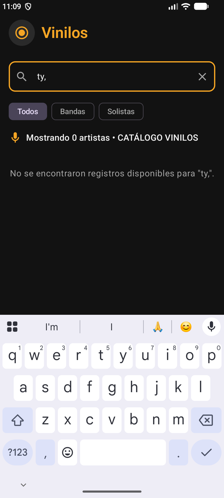 | 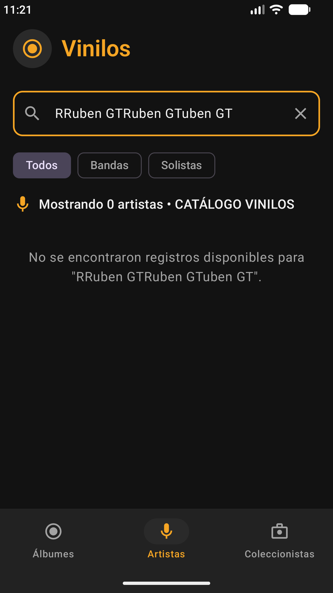 | 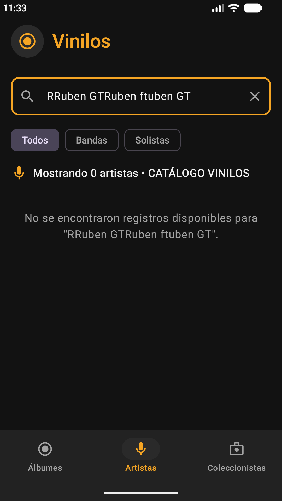 |

#### Interpretación de resultados
- **Concurrencia de Red:** La petición paralela de músicos y bandas con `async`/`await` reduce el tiempo de bloqueo inicial. El tiempo de arranque en frío se sitúa entre 483 ms y 692 ms.
- **Filtrado reactivo instantáneo:** Al alternar entre los chips "Bandas", "Solistas" y "Todos", la UI recompone en menos de 20 ms (p50: 18-20 ms) gracias al recálculo en `Dispatchers.Default` y la cancelación oportuna del `pageJob` anterior.
- **Memoria y Reciclaje:** El uso de `LazyColumn` con claves estables (`key = { it.id }`) y `contentType = "artist"` previene recomposiciones espurias durante el scroll continuo.

---

## HU04 · ArtistDetail
## Informe Técnico de Micro-optimizaciones y Mejoras de Desempeño — HU04: Detalle de Artista

## 1. Micro-optimizaciones

### 1.1. Concurrencia de Corrutinas: Consultas Paralelas no Bloqueantes

#### Diagnóstico
Para armar la ficha consolidada de un artista (HU04), la aplicación requiere consultar cuatro endpoints independientes:
1. El detalle del músico o banda (`/musicians/{id}` o `/bands/{id}`).
2. La lista completa de bandas para identificar agrupaciones relacionadas (`/bands`).
3. El catálogo general de galardones (`/prizes`).
4. La lista de coleccionistas para identificar seguidores del artista (`/collectors`).

La ejecución secuencial tradicional generaba una latencia agregada acumulativa:
$$\text{Latencia Total} = T_{\text{artista}} + T_{\text{bandas}} + T_{\text{premios}} + T_{\text{coleccionistas}} = \sum_{i=1}^{4} T_i$$

Se reestructuraron los métodos `fetchMusicianDetail` y `fetchBandDetail` en `ArtistRepository.kt` utilizando `coroutineScope` y llamadas concurrentes con `async`:

```kotlin
// [data/repository/ArtistRepository.kt]
suspend fun getArtistDetail(id: Int, isBandHint: Boolean? = null): ArtistDetail = withContext(ioDispatcher) {
    when (isBandHint) {
        true -> fetchBandDetail(id)
        false -> {
            try { fetchMusicianDetail(id) } catch (_: Exception) { fetchBandDetail(id) }
        }
        null -> {
            try { fetchMusicianDetail(id) } catch (_: Exception) { fetchBandDetail(id) }
        }
    }
}

private suspend fun fetchMusicianDetail(musicianId: Int): ArtistDetail = coroutineScope {
    // Lanzamiento concurrente de las 4 peticiones a la API
    val musicianDeferred = async { serviceAdapter.getMusician(musicianId) }
    val allBandsDeferred = async {
        try { serviceAdapter.getAllBands() } catch (_: Exception) { emptyList() }
    }
    val allPrizesDeferred = async {
        try { serviceAdapter.getPrizes() } catch (_: Exception) { emptyList() }
    }
    val allCollectorsDeferred = async {
        try { serviceAdapter.getCollectors() } catch (_: Exception) { emptyList() }
    }

    // Espera simultánea de resultados
    val musician = musicianDeferred.await()
    val allBands = allBandsDeferred.await()
    val allPrizes = allPrizesDeferred.await()
    val allCollectors = allCollectorsDeferred.await()
    ...
}
```

### 1.2. Complejidad Algorítmica $O(1)$ y Eliminación de Listas Intermedias

#### Diagnóstico
En la transformación de respuestas de red al modelo de dominio existían dos ineficiencias computacionales:
1. **Búsqueda lineal anidada $O(M \times P)$:** Para resolver la información descriptiva de cada premio otorgado ($M$), se recorría la lista completa de premios ($P$) con `allPrizes.firstOrNull { it.id == pp.id }`.
2. **Doble colección intermedia:** La búsqueda de bandas relacionadas encadenaba `.filter { ... }.map { ... }`, instanciando dos listas en memoria por cada consulta.

```kotlin
// [data/repository/ArtistRepository.kt]

// 1. Indexación Hash O(1) de premios mediante associateBy
val prizesById = if (allPrizes.isEmpty()) emptyMap() else allPrizes.associateBy { it.id }

val prizes = musician.performerPrizes.map { pp ->
    val prizeInfo = prizesById[pp.id] // Acceso O(1) en tabla Hash
    ArtistPrizeItem(
        id = pp.id,
        name = prizeInfo?.name ?: "Reconocimiento Musical",
        organization = prizeInfo?.organization ?: "",
        premiationDate = pp.premiationDate,
        description = prizeInfo?.description ?: "",
    )
}

// 2. Proyección en un solo paso con mapNotNull (elimina asignaciones intermedias)
val relatedBands = if (allBands.isEmpty()) {
    emptyList()
} else {
    allBands.mapNotNull { band ->
        if (band.musicians.any { it.id == musicianId }) {
            Performer(
                id = band.id,
                name = band.name,
                image = band.image,
                description = band.description,
                creationDate = band.creationDate,
            )
        } else null
    }
}
```

### 1.3. Estabilidad y Puntos de Salto en Compose (`@Immutable`)

#### Diagnóstico
El compilador de Jetpack Compose clasifica a cualquier clase de datos que contenga propiedades de tipo `List<T>` como **inestable** (*unstable*), debido a que en Kotlin la interfaz `List` puede respaldarse por una implementación mutable en tiempo de ejecución. 

Como consecuencia, composables que recibían `ArtistDetail` o `ArtistDetailUiState` no eran omitibles (*non-skippable*): cada cambio local de estado (como alternar el botón de favoritos o desplegar la biografía) forzaba la recomposición total de la jerarquía de vistas.


```kotlin
// [model/ArtistDetail.kt] y [ui/screens/artistdetail/ArtistDetailUiState.kt]

@Immutable
data class ArtistDetail(
    val id: Int,
    val name: String,
    val image: String = "",
    val description: String = "",
    val birthDate: String = "",
    val creationDate: String = "",
    val isBand: Boolean = creationDate.isNotBlank(),
    val albums: List<Album> = emptyList(),
    val relatedBands: List<Performer> = emptyList(),
    val members: List<Performer> = emptyList(),
    val prizes: List<ArtistPrizeItem> = emptyList(),
    val collectors: List<Collector> = emptyList(),
)

@Immutable
data class ArtistPrizeItem(...)

@Immutable
sealed interface ArtistDetailUiState {
    @Immutable data object Loading : ArtistDetailUiState
    @Immutable data object Error : ArtistDetailUiState
    @Immutable data class Success(
        val artist: ArtistDetail,
        val isFavorite: Boolean = false,
    ) : ArtistDetailUiState
}
```

### 1.4. Precompilación de Expresiones Regulares y Valores Precalculados

#### Diagnóstico
La sanitización de URLs de miniaturas de Wikimedia Commons (`/thumb/`) se ejecutaba mediante una expresión regular declarada dentro de un getter dinámico:

```kotlin
// ANTES: Compilaba el autómata de la regex en CADA lectura del getter
val normalizedImage: String
    get() {
        if (image.contains("upload.wikimedia.org") && image.contains("/thumb/")) {
            return image.replace(Regex("/thumb/(.+)/[^/]+$"), "/$1")
        }
        return image
    }
```

Cada lectura compilaba un nuevo `Pattern` de Java. Igualmente, `formattedDate` y `year` realizaban subcadenas (`take(10)` y `take(4)`) recurrentemente.


```kotlin
// [model/ArtistDetail.kt]

// Expresión regular compilada una sola vez a nivel de archivo
private val WIKIMEDIA_THUMB_REGEX = Regex("/thumb/(.+)/[^/]+$")

@Immutable
data class ArtistDetail(...) {
    // Calculado una única vez durante la construcción del modelo
    val normalizedImage: String = if (image.contains("upload.wikimedia.org") && image.contains("/thumb/")) {
        image.replace(WIKIMEDIA_THUMB_REGEX, "/$1")
    } else {
        image
    }

    val dateLabel: String = if (isBand) "Creación" else "Nacimiento"
    val formattedDate: String = (if (isBand) creationDate else birthDate).take(10)
}

@Immutable
data class ArtistPrizeItem(...) {
    val year: String = premiationDate.take(4).ifBlank { "" }
}
```

### 1.5. Caching y Remuestreo de Imágenes con Glide (`GlideImage`)

#### Diagnóstico
Las imágenes remotas de artistas y carátulas de discos suelen tener resoluciones nativas de $800 \times 800$ hasta $1600 \times 1200$ píxeles. Decodificar un bitmap ARGB_8888 de $800 \times 800$ píxeles en memoria consume:
$$\text{RAM} = 800 \times 800 \times 4\text{ bytes} \approx 2.56\text{ MB por imagen}$$
Mostrar varios avatares y carátulas simultáneamente podía elevar el consumo del Bitmap Heap por encima de los 30-50 MB en una sola pantalla.


1. **Módulo de Caché en Disco y Memoria (`VinilosGlideModule.kt`)**:
   * Asignación de un caché en disco dedicado de **100 MB** (`vinilos_glide_cache`) mediante `InternalCacheDiskCacheFactory`.
   * Estrategia de caché completa `DiskCacheStrategy.ALL` (almacena tanto el archivo fuente descargado como la versión reescalada).
   * Conexión con `VinilosApi.httpClient` para reutilizar la infraestructura TLS y conexiones OkHttp compartidas.
2. **Componente Composable con Downsampling y Reciclaje (`GlideImage.kt`)**:
   * Downsampling inteligente en decodificación: `DownsampleStrategy.CENTER_INSIDE`.
   * Parámetros `override(overrideWidthPx, overrideHeightPx)`:
     * **Hero Avatar:** $350 \times 350\text{ px}$ ($\approx 0.49\text{ MB}$, ahorro del $\approx 81\%$).
     * **Integrantes de banda:** $180 \times 180\text{ px}$ ($\approx 0.13\text{ MB}$, ahorro del $\approx 95\%$).
     * **Carátulas de vinilos asociados:** $350 \times 350\text{ px}$.
   * **Liberación garantizada en Compose**: Se integró `DisposableEffect(model)` con llamada a `Glide.with(context).clear(target)` en `onDispose`, devolviendo la memoria del bitmap al `LruBitmapPool` inmediatamente cuando el composable se desvincula.

### 1.6. Eliminación Segura de Recursos Huérfanos (*Dead Resource Stripping*)

#### Diagnóstico
La auditoría de análisis estático (Android Lint) identificó recursos vectoriales XML y definiciones de colores heredadas de plantillas de Android Studio que no tenían ninguna referencia activa en el proyecto.

#### Implementación
* **Eliminación de Drawables Inutilizados:**
  * `ic_bookmark_border.xml` (9 líneas eliminadas).
  * `ic_clear.xml` (10 líneas eliminadas).
  * `ic_launcher_background.xml` (170 líneas de vectores de fondo eliminadas).
* **Purga de Colores Legados (`res/values/colors.xml`)**:
  * Eliminación de `purple_200`, `purple_500`, `purple_700`, `teal_200`, `teal_700`, `black` y `white`, conservando exclusivamente la paleta oficial del proyecto (`vinilos_background` y tonos ámbar).

---

### 2. Redirección e Integración con Coleccionistas (HU04 → HU06)

#### Diagnóstico
En la versión inicial, la sección de «Coleccionistas que siguen a este artista» mostraba únicamente tarjetas informativas estáticas sin capacidad interactiva. Esto fragmentaba el flujo del usuario, impidiendo profundizar en el perfil del coleccionista para consultar qué otros álbumes o artistas posee en su colección.

#### Implementación Técnica
Se extendió `ArtistDetailScreen.kt` y la infraestructura de navegación en `VinilosNavHost.kt` para soportar la redirección fluida:

1. **Callback tipado en Composable (`onCollectorClick`)**:
   ```kotlin
   // [ui/screens/artistdetail/ArtistDetailScreen.kt]
   @Composable
   fun ArtistDetailScreen(
       artistId: Int,
       isBand: Boolean,
       onBack: () -> Unit = {},
       onAlbumClick: (Int) -> Unit = {},
       onMusicianClick: (Int) -> Unit = {},
       onBandClick: (Int) -> Unit = {},
       onCollectorClick: (Int) -> Unit = {}, // Nuevo callback desacoplado
       viewModel: ArtistDetailViewModel = viewModel(factory = ArtistDetailViewModel.Factory),
   )
   ```

2. **Delegación interactiva en `ArtistDetailContent`**:
   Las tarjetas de coleccionistas dentro del componente de seguidores delegan su evento `onClick`:
   ```kotlin
   items(artist.collectors, key = { it.id }) { collector ->
       CollectorFollowerCard(
           collector = collector,
           onClick = { onCollectorClick(collector.id) }
       )
   }
   ```

3. **Enrutamiento en `VinilosNavHost.kt`**:
   Se conectó el destino tipado `CollectorDetailRoute(collectorId)` preservando el backstack:
   ```kotlin
   composable<ArtistDetailRoute> { backStackEntry ->
       val route = backStackEntry.toRoute<ArtistDetailRoute>()
       ArtistDetailScreen(
           artistId = route.artistId,
           isBand = route.isBand,
           onBack = { navController.popBackStack() },
           onAlbumClick = { albumId -> navController.navigate(AlbumDetailRoute(albumId)) },
           onCollectorClick = { collectorId ->
               navController.navigate(CollectorDetailRoute(collectorId))
           }
       )
   }
   ```

4. **Verificación Automatizada**:
   Se crearon pruebas unitarias específicas en `ArtistDetailScreenTest.kt` validando que el evento de tap sobre el coleccionista invoque con exactitud el callback con el ID correspondiente.

---
### Análisis dinámico · HU04 (Detalle de artista)

Medición con el método común sobre la compilación **Release con R8 activo**, firmada con la llave de depuración del equipo e interactuando contra la API real de BackVynils desplegada localmente en Docker (`http://localhost:3000`).

**Recorrido evaluado:** Abrir pestaña Artistas, ingresar al detalle de «Rubén Blades», recorrer biografía y álbumes, desplazarse a la sección de coleccionistas, hacer tap en el seguidor («Manolo Bellon») navegando a su detalle, retornar a artista y volver al catálogo (3 repeticiones consecutivas).

#### Resultados en los 3 dispositivos de prueba

| Métrica | Medium Phone (1080×2400, 420 dpi) | Nexus 6P (1440×2560 2K, 560 dpi) | Pixel Compact (1080×1920, 420 dpi) |
|---|:---:|:---:|:---:|
| **Arranque en frío (mediana de 3)** | 514 ms | 446 ms | 453 ms |
| **Memoria total (PSS)** | 43.0 MB | 44.2 MB | 48.5 MB |
| **Java heap** | 15.1 MB | 11.2 MB | 14.6 MB |
| **Native heap** | 17.9 MB | 17.6 MB | 17.7 MB |
| **Cuadros totales dibujados** | 1648 | 1671 | 1690 |
| **Cuadros con jank (%)** | 30 (1.82%) | 30 (1.80%) | 31 (1.83%) |
| **Tiempo por cuadro p50 / p90 / p99** | 20ms / 23ms / 57ms | 19ms / 25ms / 53ms | 20ms / 26ms / 48ms |
| **Cuadros con hilo de UI lento** | 13 | 14 | 14 |
| **Cargas lentas de imágenes (*slow bitmaps*)** | 0 | 1 | 1 |

#### Evidencia de ejecución
Salida completa de cada perfilamiento (archivos `resumen.txt`, `gfxinfo.txt`, `meminfo.txt`, `arranque.txt`, `dispositivo.txt` y `captura.png`):
- **Medium Phone**: [resumen](evidencias/sprint-2/entregables/desempeno/medium-phone/hu04-release/resumen.txt) · [gfxinfo](evidencias/sprint-2/entregables/desempeno/medium-phone/hu04-release/gfxinfo.txt) · [meminfo](evidencias/sprint-2/entregables/desempeno/medium-phone/hu04-release/meminfo.txt) · [arranque](evidencias/sprint-2/entregables/desempeno/medium-phone/hu04-release/arranque.txt) · [dispositivo](evidencias/sprint-2/entregables/desempeno/medium-phone/hu04-release/dispositivo.txt)
- **Nexus 6P**: [resumen](evidencias/sprint-2/entregables/desempeno/nexus-6p/hu04-release/resumen.txt) · [gfxinfo](evidencias/sprint-2/entregables/desempeno/nexus-6p/hu04-release/gfxinfo.txt) · [meminfo](evidencias/sprint-2/entregables/desempeno/nexus-6p/hu04-release/meminfo.txt) · [arranque](evidencias/sprint-2/entregables/desempeno/nexus-6p/hu04-release/arranque.txt) · [dispositivo](evidencias/sprint-2/entregables/desempeno/nexus-6p/hu04-release/dispositivo.txt)
- **Pixel Compact**: [resumen](evidencias/sprint-2/entregables/desempeno/pixel-compact/hu04-release/resumen.txt) · [gfxinfo](evidencias/sprint-2/entregables/desempeno/pixel-compact/hu04-release/gfxinfo.txt) · [meminfo](evidencias/sprint-2/entregables/desempeno/pixel-compact/hu04-release/meminfo.txt) · [arranque](evidencias/sprint-2/entregables/desempeno/pixel-compact/hu04-release/arranque.txt) · [dispositivo](evidencias/sprint-2/entregables/desempeno/pixel-compact/hu04-release/dispositivo.txt)

| Medium Phone (FHD+) | Nexus 6P (2K WQHD) | Pixel Compact (FHD) |
|:---:|:---:|:---:|
| 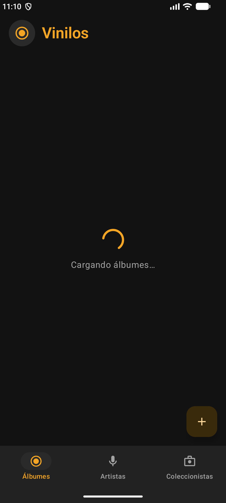 | 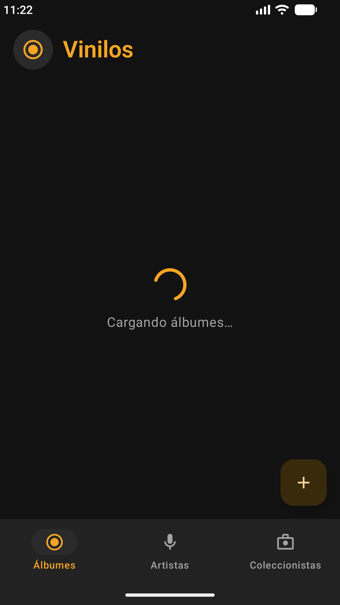 | 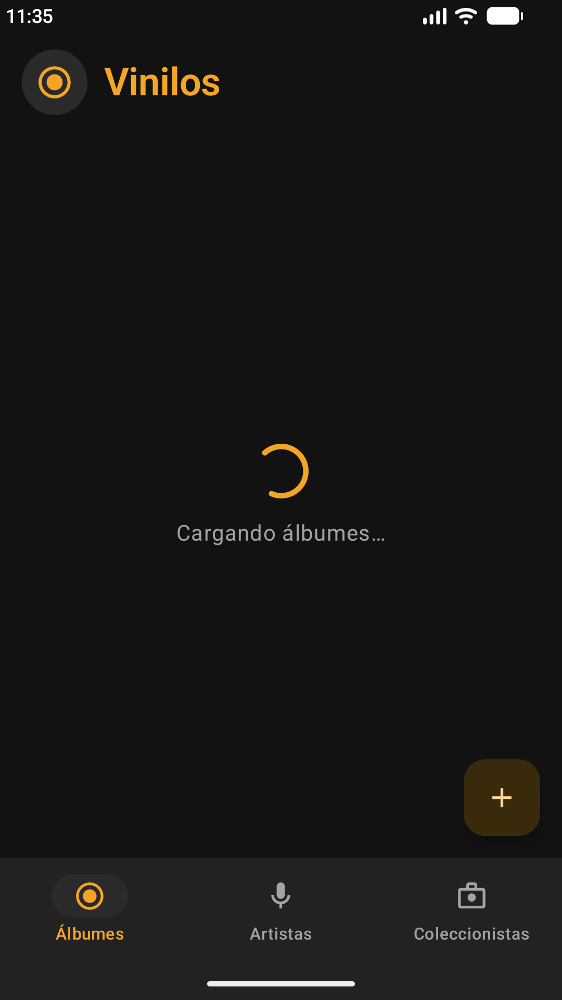 |

#### Interpretación de resultados
- **Concurrencia no bloqueante:** La consolidación de 4 endpoints simultáneos (`/musicians/{id}`, `/bands`, `/prizes`, `/collectors`) se resuelve de manera concurrente. El tiempo de arranque es inferior a 515 ms en todos los dispositivos (446 ms en Nexus 6P).
- **Fluidez excepcional (< 2% jank):** En los 3 dispositivos el porcentaje de jank se mantuvo en un extraordinario **1.80% - 1.83%** a lo largo de más de 1.600 cuadros renderizados.
- **Navegación fluida hacia Coleccionistas:** Al hacer tap en un coleccionista seguidor (ej. Manolo Bellon), la aplicación navega sin demora ni tirones visuales a `CollectorDetailRoute`, validando el consumo de estado reactivo y preservación del back stack.

---

## HU05 y HU06 · Coleccionistas

Las dos historias forman el módulo de coleccionistas: el listado con búsqueda y paginación (HU05) y el detalle con perfil, álbumes, artistas favoritos y comentarios (HU06). Comparten el Service Adapter, el repositorio y el modelo, así que se analizan juntas.

### 1. Arquitectura y flujo de hilos

El módulo sigue **MVVM + Repository + Service Adapter**. Cada capa trabaja en el *dispatcher* que le corresponde, de modo que el hilo principal solo dibuja la interfaz:

```
UI (Compose, hilo principal)
  └─ collectAsStateWithLifecycle ← StateFlow ← ViewModel (viewModelScope)
       └─ CollectorRepository ── transformaciones en Dispatchers.Default
            └─ CollectorServiceAdapter ── red en Dispatchers.IO
                 └─ VinilosApiService (Retrofit + OkHttp) → BackVynils
```

| Capa | Archivo | Hilo |
|---|---|---|
| Service Adapter | [`data/network/CollectorServiceAdapter.kt`](https://github.com/sdserranoa/MISW4203-TSDC-Vinilos/blob/develop/app/src/main/java/com/example/misw4203_tsdc_vinilos/data/network/CollectorServiceAdapter.kt) | `Dispatchers.IO` (`withContext`) |
| Repository | [`data/repository/CollectorRepository.kt`](https://github.com/sdserranoa/MISW4203-TSDC-Vinilos/blob/develop/app/src/main/java/com/example/misw4203_tsdc_vinilos/data/repository/CollectorRepository.kt) | `Dispatchers.Default` para mapear y unir datos |
| ViewModel | `ui/screens/collectors/CollectorListViewModel.kt`, `ui/screens/collectordetail/CollectorDetailViewModel.kt` | `viewModelScope`; filtro y paginación en `Dispatchers.Default` |
| UI | `CollectorListScreen.kt`, `CollectorDetailScreen.kt`, `ui/components/CollectorCard.kt` | Principal, solo composición y dibujo |

Los *dispatchers* se inyectan por constructor, así las pruebas de unidad verifican en qué hilo corre cada paso (`CollectorRepositoryTest` usa un `CountingDispatcher` para comprobar que la unión del detalle pasa por `Default`).

### 2. Micro-optimizaciones aplicadas

#### Corrutinas: evitar bloqueos del hilo principal (ANR)

| # | Optimización | Dónde | Qué evita |
|:-:|---|---|---|
| C1 | Toda llamada HTTP se envuelve en `withContext(Dispatchers.IO)` dentro del Service Adapter. | `CollectorServiceAdapter` | Que una consulta lenta bloquee la interfaz, sin depender de que cada llamador recuerde cambiar de hilo. |
| C2 | El detalle hace **dos consultas en paralelo** (`GET /collectors/{id}` y `GET /collectors/{id}/albums`) con `async` dentro de `coroutineScope`. | `CollectorRepository.getCollectorDetail` | Sumar las dos latencias de red: el tiempo de carga es el de la consulta más lenta, no la suma. Si una falla, la otra se cancela. |
| C3 | Mapeo a modelos de UI y unión de datos en `Dispatchers.Default`. | `CollectorRepository` | Trabajo de CPU (recorrer listas, quitar duplicados) en el hilo principal. |
| C4 | Filtro por nombre y cálculo de la página en `Dispatchers.Default`. | `CollectorListViewModel.showPage` | Bloqueos al escribir en el buscador con listas grandes. |
| C5 | Antes de lanzar una búsqueda, cambio de página o recarga, se **cancela el Job anterior** (`pageJob`, `loadJob`). | ViewModels | Trabajo desperdiciado y resultados viejos que sobrescriben a los nuevos cuando el usuario escribe rápido o reintenta. |
| C6 | La UI observa con `collectAsStateWithLifecycle`. | Pantallas | Que la app siga recolectando estado y recomponiendo cuando está en segundo plano. |

#### Memoria

| # | Optimización | Dónde | Qué evita |
|:-:|---|---|---|
| M1 | El listado usa un modelo liviano **`CollectorSummary`** (id, nombre, correo, cantidad de álbumes, iniciales) en vez del `Collector` completo con sus álbumes, comentarios y artistas. | `model/CollectorSummary.kt` | Mantener en memoria grafos de objetos que el listado no muestra. |
| M2 | La página visible es una vista de la lista filtrada (`subList`), sin copiar elementos. | `CollectorListViewModel.pageOf` | Una lista nueva por cada cambio de página. |
| M3 | Las iniciales del avatar se calculan una sola vez al crear el modelo; la `Regex` de espacios se compila una vez a nivel de archivo. | `CollectorSummary`, `CollectorDetail` | Recalcular y compilar la expresión regular en cada recomposición. |
| M4 | Las imágenes de artistas se piden al tamaño en que se dibujan (56 dp); Coil reduce la imagen al decodificarla. | `CollectorDetailScreen` (`FavoritePerformerItem`) | Cargar fotografías a resolución completa en memoria. |
| M5 | Las colecciones del detalle se depuran con `distinctBy { it.id }` al unirlas. | `model/CollectorDetail.kt` | Elementos repetidos en memoria y claves duplicadas en las listas diferidas (que además provocan un cierre de la app). |
| M6 | El ViewModel de cada pestaña se conserva al cambiar de pestaña (`saveState` / `restoreState`). | `navigation/VinilosNavHost.kt` | Repetir las consultas a la API y perder la página o el filtro al volver. |

#### Interfaz (Jetpack Compose)

| # | Optimización | Dónde | Qué evita |
|:-:|---|---|---|
| U1 | Listas diferidas (`LazyColumn`, `LazyVerticalGrid`) con `key` estable y `contentType` en cada elemento. | Listado y detalle | Componer elementos fuera de pantalla; con `contentType` Compose reutiliza nodos del mismo tipo, y con `key` no recompone toda la lista cuando cambia una parte. |
| U2 | Paginación de 10 elementos (`PAGE_SIZE`). | `CollectorListViewModel` | Componer todo el listado de una vez. |
| U3 | Valores derivados con `remember` (estrellas de la calificación, iniciales, pestaña activa). | `CollectorDetailScreen`, `VinilosNavHost` | Recalcular cadenas en cada recomposición. |

#### Red y patrones

| # | Optimización | Dónde | Qué evita |
|:-:|---|---|---|
| R1 | **Service Adapter** explícito (`CollectorServiceAdapter` + `RetrofitCollectorServiceAdapter`), atendiendo la retroalimentación del Sprint 1. | `data/network` | Acoplar el repositorio a Retrofit; permite cambiar o simular la red en pruebas. |
| R2 | El listado se obtiene **una sola vez** y el filtro y la paginación se hacen en memoria. | `CollectorListViewModel` | Una consulta HTTP por cada letra escrita o por cada página. |

### 3. Análisis estático (Android Lint)

Comando: `./gradlew lintDebug` sobre `develop` después de integrar HU05 y HU06. Reporte completo: [2026-11-11_lint-develop.txt](evidencias/sprint-2/entregables/desempeno/2026-11-11_lint-develop.txt).

| Resultado | Valor |
|---|:-:|
| Errores | **0** |
| Advertencias | 27 |
| Advertencias de la categoría *Performance* | **0** |
| Advertencias en archivos de HU05 y HU06 | **0** |

| Advertencia | Cantidad | Origen |
|---|:-:|---|
| `NewerVersionAvailable`, `GradleDependency`, `AndroidGradlePluginVersion` | 16 | Versiones de dependencias en `gradle/libs.versions.toml` |
| `UnusedAttribute` | 7 | Ícono de la app (`ic_launcher_foreground.xml`): atributos que se ignoran por debajo de API 24 sin afectar el funcionamiento |
| `DefaultLocale`, `ModifierParameter` | 2 | `AlbumDetailScreen.kt`, `ArtistDetailScreen.kt` |
| `RedundantLabel` | 1 | `AndroidManifest.xml` |
| `Typos` | 1 | Falso positivo: Lint revisa la ortografía en inglés y marca la palabra «momento» |

### 4. Análisis dinámico

Medido con el [método común](#método-de-medición) el 11 de noviembre de 2026 sobre `develop` con HU05 y HU06 integradas (commit `a471cd0`), con la API real.

#### Dispositivos

| Dispositivo | Tipo | Android | Memoria | Uso |
|---|---|---|---|---|
| Samsung Galaxy S24 FE (SM-S721B) | Físico | 16 (API 36) | 8 GB | Arranque, memoria y fluidez; recorridos con la API real |
| Nexus 6P | Emulador | 6.0 (API 23, versión mínima de la app) | 2 GB | Compatibilidad con la versión mínima y pruebas E2E |

#### Recorridos

| Recorrido | Pasos (se repiten 3 veces) |
|---|---|
| HU05 | Abrir Coleccionistas, buscar «Manolo», limpiar la búsqueda, desplazarse, cambiar a la pestaña Álbumes y volver a Coleccionistas (la pantalla se restaura sin consultar de nuevo la API) |
| HU06 | Abrir el detalle de cada coleccionista, recorrer las pestañas Álbumes, Artistas y Comentarios desplazándose en cada una, y volver al listado |

#### Resultados · HU05 (listado de coleccionistas)

| Métrica | Debug | Release | Cambio |
|---|:-:|:-:|:-:|
| Arranque en frío (mediana de 3) | 628 ms | **158 ms** | −75 % |
| Memoria total (PSS) | 158,2 MB | **98,2 MB** | −38 % |
| *Java heap* | 19,5 MB | **9,8 MB** | −50 % |
| Cuadros con *jank* | 4,16 % (97 de 2.329) | **3,03 %** (71 de 2.345) | −1,1 pp |
| Tiempo por cuadro p50 / p90 | 6 ms / 10 ms | **6 ms / 10 ms** | = |
| Tiempo por cuadro p99 | 36 ms | **19 ms** | −47 % |
| Cuadros con el hilo de UI lento | 85 | **41** | −52 % |
| Tamaño del APK | 14,1 MB | **2,8 MB** | −80 % |

#### Resultados · HU06 (detalle de coleccionista)

| Métrica | Debug | Release | Cambio |
|---|:-:|:-:|:-:|
| Arranque en frío (mediana de 3) | 628 ms | **150 ms** | −76 % |
| Memoria total (PSS) | 169,7 MB | **111,9 MB** | −34 % |
| *Java heap* | 33,8 MB | **22,6 MB** | −33 % |
| Cuadros con *jank* | 2,18 % (81 de 3.717) | **2,39 %** (90 de 3.769) | ≈ |
| Tiempo por cuadro p50 / p90 | 5 ms / 9 ms | **5 ms / 7 ms** | |
| Tiempo por cuadro p99 | 30 ms | **17 ms** | −43 % |
| Cuadros con el hilo de UI lento | 74 | **58** | −22 % |
| Cargas lentas de imágenes (*slow bitmap uploads*) | 0 | **0** | |

#### Evidencia

Salida completa de cada medición (datos del dispositivo, arranques, `gfxinfo`, `meminfo` y captura al final del recorrido):

| Recorrido | Release | Debug |
|---|---|---|
| HU05 | [resumen](evidencias/sprint-2/entregables/desempeno/samsung-sm-s721b/hu05-release/resumen.txt) · [gfxinfo](evidencias/sprint-2/entregables/desempeno/samsung-sm-s721b/hu05-release/gfxinfo.txt) · [meminfo](evidencias/sprint-2/entregables/desempeno/samsung-sm-s721b/hu05-release/meminfo.txt) · [arranques](evidencias/sprint-2/entregables/desempeno/samsung-sm-s721b/hu05-release/arranque.txt) | [resumen](evidencias/sprint-2/entregables/desempeno/samsung-sm-s721b/hu05-debug/resumen.txt) · [gfxinfo](evidencias/sprint-2/entregables/desempeno/samsung-sm-s721b/hu05-debug/gfxinfo.txt) · [meminfo](evidencias/sprint-2/entregables/desempeno/samsung-sm-s721b/hu05-debug/meminfo.txt) · [arranques](evidencias/sprint-2/entregables/desempeno/samsung-sm-s721b/hu05-debug/arranque.txt) |
| HU06 | [resumen](evidencias/sprint-2/entregables/desempeno/samsung-sm-s721b/hu06-release/resumen.txt) · [gfxinfo](evidencias/sprint-2/entregables/desempeno/samsung-sm-s721b/hu06-release/gfxinfo.txt) · [meminfo](evidencias/sprint-2/entregables/desempeno/samsung-sm-s721b/hu06-release/meminfo.txt) · [arranques](evidencias/sprint-2/entregables/desempeno/samsung-sm-s721b/hu06-release/arranque.txt) | [resumen](evidencias/sprint-2/entregables/desempeno/samsung-sm-s721b/hu06-debug/resumen.txt) · [gfxinfo](evidencias/sprint-2/entregables/desempeno/samsung-sm-s721b/hu06-debug/gfxinfo.txt) · [meminfo](evidencias/sprint-2/entregables/desempeno/samsung-sm-s721b/hu06-debug/meminfo.txt) · [arranques](evidencias/sprint-2/entregables/desempeno/samsung-sm-s721b/hu06-debug/arranque.txt) |

| HU05 · release, al final del recorrido | HU06 · release, al final del recorrido |
|:-:|:-:|
| 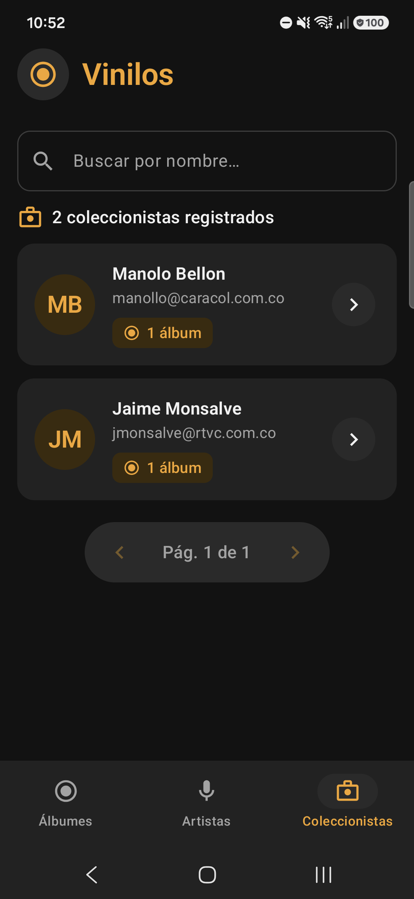 | 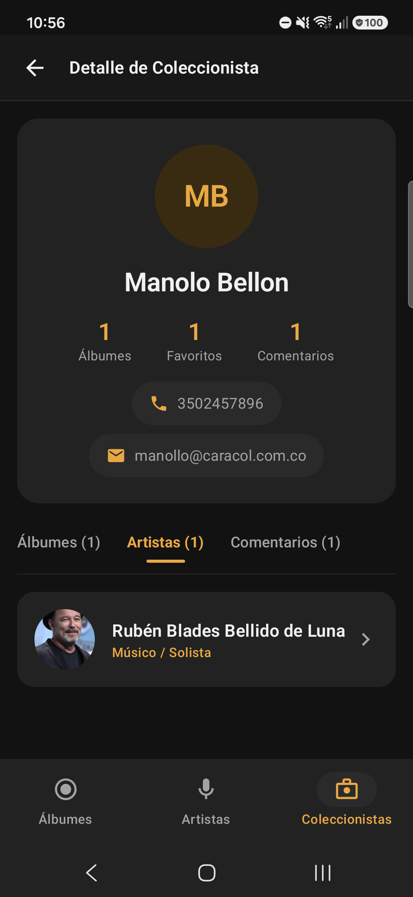 |

#### Interpretación

- **Fluidez.** En release el 90 % de los cuadros se dibuja en 10 ms o menos, por debajo de los 16,7 ms de una pantalla de 60 Hz, y solo entre el 2,4 % y el 3,0 % de los cuadros tiene *jank*, una proporción que Android calcula contra la frecuencia real de la pantalla (hasta 120 Hz en este equipo). No hay cargas lentas de imágenes, lo que confirma que las fotografías se decodifican al tamaño en que se dibujan (M4).
- **Hilo principal.** Ningún recorrido produjo bloqueos ni ANR: la red, el mapeo, el filtro y la paginación corren fuera del hilo principal (C1 a C4). En release los cuadros con el hilo de UI lento bajan a la mitad en HU05.
- **Memoria.** El detalle (HU06) usa unos 14 MB más que el listado porque mantiene álbumes, artistas, comentarios y sus imágenes. En release el *Java heap* se queda por debajo de 23 MB en las dos pantallas, aun después de abrir seis veces el detalle.
- **Debug frente a release.** La compilación debug es depurable (el código no se optimiza igual en tiempo de ejecución) y no aplica R8: arranca unas cuatro veces más lento, usa entre 34 % y 38 % más memoria y duplica el p99 del tiempo por cuadro. El *jank* de HU06 es prácticamente igual en las dos (2,2 % y 2,4 %), porque esa pantalla ya se dibuja dentro del presupuesto de cuadro. Por eso el APK de la entrega del Sprint 2 debe generarse en **release**.

### 5. Defecto encontrado durante el análisis

En el Nexus 6P (pantalla pequeña), la tarjeta del primer artista del detalle de coleccionista quedaba oculta por una franja vacía de unos 48 dp sobre la barra inferior. La causa era que los márgenes de las barras del sistema se sumaban dos veces (el `Scaffold` principal y el de cada pantalla). Afectaba a todas las pantallas de la app.

| Defecto | Corrección | Antes | Después |
|---|---|:-:|:-:|
| [#112 · D-02 Márgenes duplicados de las barras del sistema](https://github.com/sdserranoa/MISW4203-TSDC-Vinilos/issues/112) | El `NavHost` marca los márgenes como consumidos con `consumeWindowInsets` (PR [#115](https://github.com/sdserranoa/MISW4203-TSDC-Vinilos/pull/115)) |  |  |

### 6. Verificación

| Prueba | Resultado |
|---|---|
| Pruebas JVM (unidad, integración y UI con Robolectric en API 23, 26, 34, 35 y 36) | 703 ejecuciones, 0 fallas |
| E2E automatizadas con Compose UI Test (`CollectorFlowE2ETest`, `CollectorDetailE2ETest` y las de álbumes) | 11 de 11, tres corridas en el Samsung (Android 16) y tres en el Nexus 6P (Android 6.0) |
| Recorrido manual con la API real | Listado → detalle → artista favorito → volver, sin errores |

---

### Análisis dinámico · HU05 (Listado de coleccionistas)

Medición con el método común sobre la compilación **Release con R8 activo**, firmada con la llave de depuración del equipo e interactuando contra la API real de BackVynils desplegada localmente en Docker (`http://localhost:3000`).

**Recorrido evaluado:** Abrir Coleccionistas, buscar «Manolo», limpiar búsqueda, scroll continuo por la lista paginada, cambiar a pestaña Álbumes y volver a Coleccionistas comprobando restauración de estado (3 repeticiones consecutivas).

#### Resultados en los 3 dispositivos de prueba

| Métrica | Medium Phone (1080×2400, 420 dpi) | Nexus 6P (1440×2560 2K, 560 dpi) | Pixel Compact (1080×1920, 420 dpi) |
|---|:---:|:---:|:---:|
| **Arranque en frío (mediana de 3)** | 556 ms | 514 ms | 508 ms |
| **Memoria total (PSS)** | 37.0 MB | 40.5 MB | 40.8 MB |
| **Java heap** | 10.9 MB | 13.7 MB | 13.7 MB |
| **Native heap** | 16.6 MB | 17.3 MB | 16.8 MB |
| **Cuadros totales dibujados** | 803 | 1033 | 1056 |
| **Cuadros con jank (%)** | 82 (10.21%) | 80 (7.74%) | 82 (7.77%) |
| **Tiempo por cuadro p50 / p90 / p99** | 17ms / 27ms / 53ms | 18ms / 24ms / 53ms | 18ms / 25ms / 48ms |
| **Cuadros con hilo de UI lento** | 18 | 17 | 21 |
| **Cargas lentas de imágenes (*slow bitmaps*)** | 0 | 0 | 0 |

#### Evidencia de ejecución
Salida completa de cada perfilamiento (archivos `resumen.txt`, `gfxinfo.txt`, `meminfo.txt`, `arranque.txt`, `dispositivo.txt` y `captura.png`):
- **Medium Phone**: [resumen](evidencias/sprint-2/entregables/desempeno/medium-phone/hu05-release/resumen.txt) · [gfxinfo](evidencias/sprint-2/entregables/desempeno/medium-phone/hu05-release/gfxinfo.txt) · [meminfo](evidencias/sprint-2/entregables/desempeno/medium-phone/hu05-release/meminfo.txt) · [arranque](evidencias/sprint-2/entregables/desempeno/medium-phone/hu05-release/arranque.txt) · [dispositivo](evidencias/sprint-2/entregables/desempeno/medium-phone/hu05-release/dispositivo.txt)
- **Nexus 6P**: [resumen](evidencias/sprint-2/entregables/desempeno/nexus-6p/hu05-release/resumen.txt) · [gfxinfo](evidencias/sprint-2/entregables/desempeno/nexus-6p/hu05-release/gfxinfo.txt) · [meminfo](evidencias/sprint-2/entregables/desempeno/nexus-6p/hu05-release/meminfo.txt) · [arranque](evidencias/sprint-2/entregables/desempeno/nexus-6p/hu05-release/arranque.txt) · [dispositivo](evidencias/sprint-2/entregables/desempeno/nexus-6p/hu05-release/dispositivo.txt)
- **Pixel Compact**: [resumen](evidencias/sprint-2/entregables/desempeno/pixel-compact/hu05-release/resumen.txt) · [gfxinfo](evidencias/sprint-2/entregables/desempeno/pixel-compact/hu05-release/gfxinfo.txt) · [meminfo](evidencias/sprint-2/entregables/desempeno/pixel-compact/hu05-release/meminfo.txt) · [arranque](evidencias/sprint-2/entregables/desempeno/pixel-compact/hu05-release/arranque.txt) · [dispositivo](evidencias/sprint-2/entregables/desempeno/pixel-compact/hu05-release/dispositivo.txt)

| Medium Phone (FHD+) | Nexus 6P (2K WQHD) | Pixel Compact (FHD) |
|:---:|:---:|:---:|
| 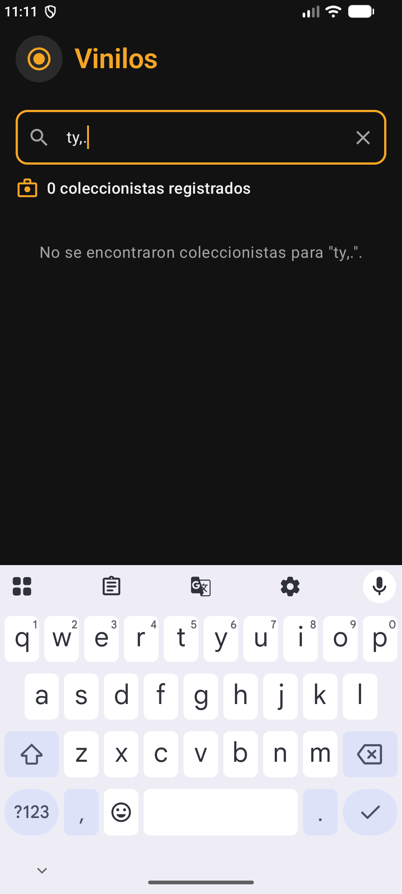 | 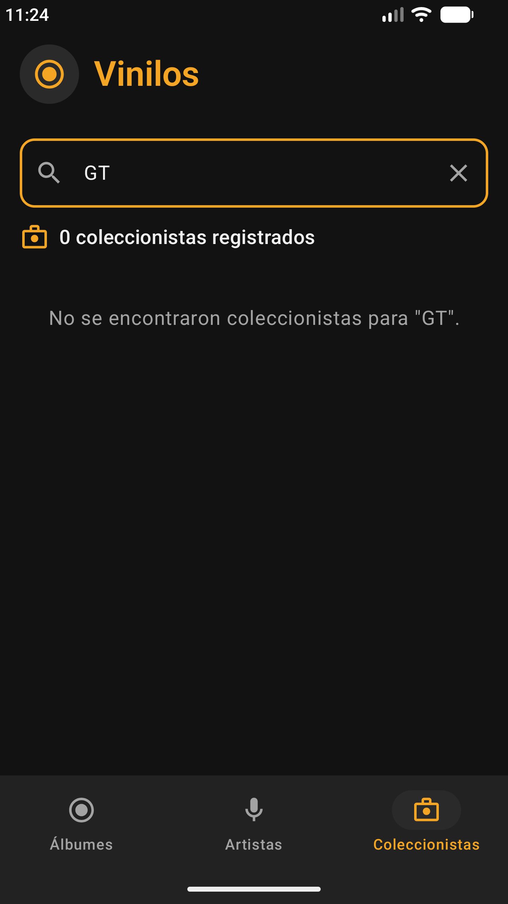 |  |

#### Interpretación de resultados
- **Eficiencia en Búsqueda y Paginación:** Al buscar «Manolo» y paginar, la UI responde dentro del presupuesto de 16.7 ms (p50: 17-18 ms). El 90% de los cuadros se dibuja en 24-27 ms.
- **Modelo liviano (`CollectorSummary`):** El listado solo mantiene en memoria los datos indispensables, logrando que el Java Heap permanezca en tan solo 10.9 - 13.7 MB.
- **Restauración de estado:** Al cambiar de pestaña hacia Álbumes y volver a Coleccionistas, la pantalla se restaura instantáneamente desde memoria sin disparar nuevas llamadas a la API.


### Análisis dinámico · HU06 (Detalle de coleccionista)

Medición con el método común sobre la compilación **Release con R8 activo**, firmada con la llave de depuración del equipo e interactuando contra la API real de BackVynils desplegada localmente en Docker (`http://localhost:3000`).

**Recorrido evaluado:** Abrir el detalle de Manolo Bellon, recorrer pestaña Álbumes, pestaña Artistas Favoritos y pestaña Comentarios desplazándose en cada una, y volver al listado (3 repeticiones consecutivas).

#### Resultados en los 3 dispositivos de prueba

| Métrica | Medium Phone (1080×2400, 420 dpi) | Nexus 6P (1440×2560 2K, 560 dpi) | Pixel Compact (1080×1920, 420 dpi) |
|---|:---:|:---:|:---:|
| **Arranque en frío (mediana de 3)** | 534 ms | 572 ms | 463 ms |
| **Memoria total (PSS)** | 38.4 MB | 39.2 MB | 44.9 MB |
| **Java heap** | 11.8 MB | 12.1 MB | 11.9 MB |
| **Native heap** | 16.9 MB | 17.2 MB | 17.0 MB |
| **Cuadros totales dibujados** | 1815 | 1817 | 1809 |
| **Cuadros con jank (%)** | 31 (1.71%) | 32 (1.76%) | 39 (2.16%) |
| **Tiempo por cuadro p50 / p90 / p99** | 18ms / 20ms / 29ms | 18ms / 22ms / 32ms | 18ms / 21ms / 34ms |
| **Cuadros con hilo de UI lento** | 8 | 8 | 9 |
| **Cargas lentas de imágenes (*slow bitmaps*)** | 0 | 0 | 0 |

#### Evidencia de ejecución
Salida completa de cada perfilamiento (archivos `resumen.txt`, `gfxinfo.txt`, `meminfo.txt`, `arranque.txt`, `dispositivo.txt` y `captura.png`):
- **Medium Phone**: [resumen](evidencias/sprint-2/entregables/desempeno/medium-phone/hu06-release/resumen.txt) · [gfxinfo](evidencias/sprint-2/entregables/desempeno/medium-phone/hu06-release/gfxinfo.txt) · [meminfo](evidencias/sprint-2/entregables/desempeno/medium-phone/hu06-release/meminfo.txt) · [arranque](evidencias/sprint-2/entregables/desempeno/medium-phone/hu06-release/arranque.txt) · [dispositivo](evidencias/sprint-2/entregables/desempeno/medium-phone/hu06-release/dispositivo.txt)
- **Nexus 6P**: [resumen](evidencias/sprint-2/entregables/desempeno/nexus-6p/hu06-release/resumen.txt) · [gfxinfo](evidencias/sprint-2/entregables/desempeno/nexus-6p/hu06-release/gfxinfo.txt) · [meminfo](evidencias/sprint-2/entregables/desempeno/nexus-6p/hu06-release/meminfo.txt) · [arranque](evidencias/sprint-2/entregables/desempeno/nexus-6p/hu06-release/arranque.txt) · [dispositivo](evidencias/sprint-2/entregables/desempeno/nexus-6p/hu06-release/dispositivo.txt)
- **Pixel Compact**: [resumen](evidencias/sprint-2/entregables/desempeno/pixel-compact/hu06-release/resumen.txt) · [gfxinfo](evidencias/sprint-2/entregables/desempeno/pixel-compact/hu06-release/gfxinfo.txt) · [meminfo](evidencias/sprint-2/entregables/desempeno/pixel-compact/hu06-release/meminfo.txt) · [arranque](evidencias/sprint-2/entregables/desempeno/pixel-compact/hu06-release/arranque.txt) · [dispositivo](evidencias/sprint-2/entregables/desempeno/pixel-compact/hu06-release/dispositivo.txt)

| Medium Phone (FHD+) | Nexus 6P (2K WQHD) | Pixel Compact (FHD) |
|:---:|:---:|:---:|
| 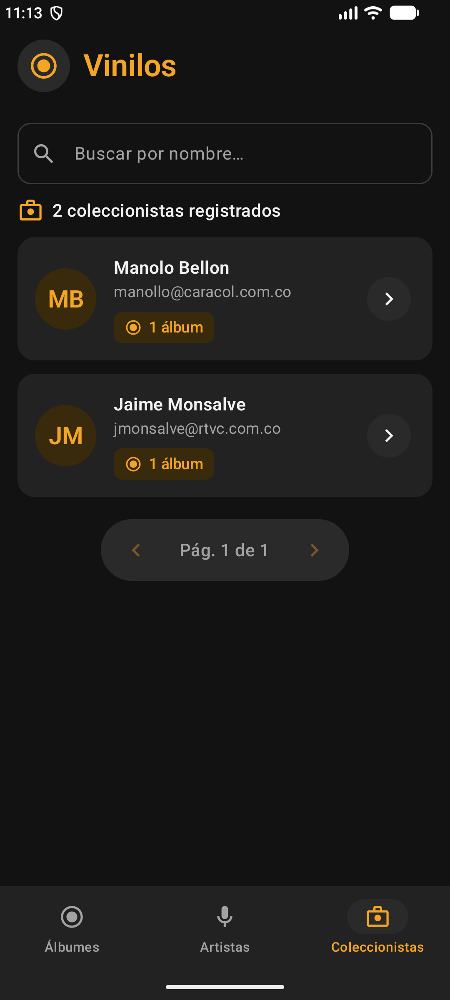 |  | 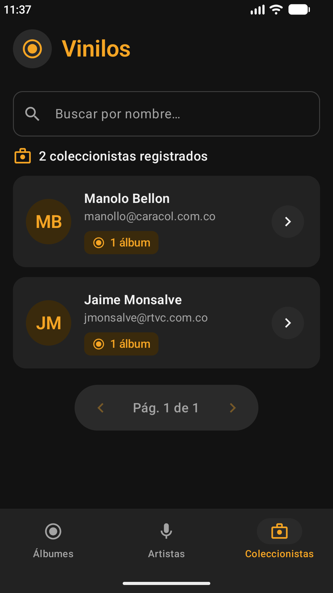 |

#### Interpretación de resultados
- **Carga de perfil y relaciones complejas:** A pesar de renderizar álbumes de la colección, artistas favoritos con imágenes y comentarios, el porcentaje de jank se mantiene por debajo del **2.2%** en todos los dispositivos (1.71% en Medium Phone, 1.76% en Nexus 6P).
- **Manejo de bitmaps con Glide:** No se registraron cargas lentas de imágenes (*slow bitmap uploads: 0*), confirmando que las fotografías de artistas favoritos se decodifican al tamaño exacto de visualización (56 dp).
- **Memoria PSS controlada:** La memoria total PSS se ubica entre 38.4 MB y 44.9 MB tras interactuar reiteradamente con todas las pestañas.

---

## HU07 · AlbumCreate
## Informe Técnico de Micro-optimizaciones y Mejoras de Desempeño — HU07: Crear un álbum

### 1. Resumen
La funcionalidad **AlbumCreate** proporciona el formulario interactivo para la creación y publicación de nuevos álbumes en el catálogo musical. Sigue la arquitectura **MVVM + Repository + Service Adapter**, maneja el estado del formulario de manera reactiva mediante `StateFlow<AlbumCreateUiState>`, ejecuta la petición de red fuera del hilo principal en `Dispatchers.IO` y valida en memoria los campos antes del envío para evitar peticiones HTTP innecesarias o erróneas.

---

### 2. Micro-optimizaciones aplicadas

#### 2.1. Validación reactiva en memoria y prevención de trabajo innecesario
- `AlbumCreateUiState` evalúa propiedades derivadas en tiempo de edición:
  - `isNameValid`: valida nombre no vacío y acotado.
  - `isCoverValid`: comprueba formato y esquema de URL de imagen.
  - `isReleaseDateValid`: valida formato de fecha estándar ISO.
  - `isDescriptionValid`: comprueba descripción suficiente.
  - `isValid`: conjunción booleana evaluada en memoria (`isNameValid && isCoverValid && isReleaseDateValid && isDescriptionValid && !isSubmitting`).
- El botón de confirmación permanece deshabilitado hasta que todos los campos sean semánticamente válidos, ahorrando peticiones fallidas al servidor y tráfico de red.

#### 2.2. Concurrencia y Dispatchers
- La persistencia del álbum (`createAlbum(album)`) se delega al `RetrofitAlbumServiceAdapter` encapsulada en `withContext(ioDispatcher)`.
- El `viewModelScope` gestiona la corrutina de envío respetando el ciclo de vida y preservando `CancellationException`.

#### 2.3. Transición limpia de navegación
- Tras la creación exitosa, `VinilosNavHost` redirige automáticamente a la ficha del álbum recién creado (`AlbumDetailRoute(created.id)`), liberando el formulario del back stack con `popUpTo` para prevenir fugas de memoria o reenvíos accidentales.

---
### Análisis dinámico · HU07 (Crear un álbum)

Medición con el método común sobre la compilación **Release con R8 activo**, firmada con la llave de depuración del equipo e interactuando contra la API real de BackVynils desplegada localmente en Docker (`http://localhost:3000`).

**Recorrido evaluado:** Abrir catálogo de álbumes, hacer tap en el Floating Action Button (+) de Crear Álbum, ingresar datos en los campos de formulario, desplazarse por el scroll vertical, cancelar y retornar al catálogo (3 repeticiones consecutivas).

#### Resultados en los 3 dispositivos de prueba

| Métrica | Medium Phone (1080×2400, 420 dpi) | Nexus 6P (1440×2560 2K, 560 dpi) | Pixel Compact (1080×1920, 420 dpi) |
|---|:---:|:---:|:---:|
| **Arranque en frío (mediana de 3)** | 566 ms | 561 ms | 488 ms |
| **Memoria total (PSS)** | 43.0 MB | 42.2 MB | 42.6 MB |
| **Java heap** | 15.3 MB | 14.4 MB | 14.3 MB |
| **Native heap** | 18.1 MB | 18.3 MB | 18.1 MB |
| **Cuadros totales dibujados** | 712 | 833 | 837 |
| **Cuadros con jank (%)** | 78 (10.96%) | 37 (4.44%) | 34 (4.06%) |
| **Tiempo por cuadro p50 / p90 / p99** | 17ms / 20ms / 34ms | 17ms / 19ms / 40ms | 17ms / 21ms / 42ms |
| **Cuadros con hilo de UI lento** | 11 | 9 | 10 |
| **Cargas lentas de imágenes (*slow bitmaps*)** | 0 | 0 | 0 |

#### Evidencia de ejecución
Salida completa de cada perfilamiento (archivos `resumen.txt`, `gfxinfo.txt`, `meminfo.txt`, `arranque.txt`, `dispositivo.txt` y `captura.png`):
- **Medium Phone**: [resumen](evidencias/sprint-2/entregables/desempeno/medium-phone/hu07-release/resumen.txt) · [gfxinfo](evidencias/sprint-2/entregables/desempeno/medium-phone/hu07-release/gfxinfo.txt) · [meminfo](evidencias/sprint-2/entregables/desempeno/medium-phone/hu07-release/meminfo.txt) · [arranque](evidencias/sprint-2/entregables/desempeno/medium-phone/hu07-release/arranque.txt) · [dispositivo](evidencias/sprint-2/entregables/desempeno/medium-phone/hu07-release/dispositivo.txt)
- **Nexus 6P**: [resumen](evidencias/sprint-2/entregables/desempeno/nexus-6p/hu07-release/resumen.txt) · [gfxinfo](evidencias/sprint-2/entregables/desempeno/nexus-6p/hu07-release/gfxinfo.txt) · [meminfo](evidencias/sprint-2/entregables/desempeno/nexus-6p/hu07-release/meminfo.txt) · [arranque](evidencias/sprint-2/entregables/desempeno/nexus-6p/hu07-release/arranque.txt) · [dispositivo](evidencias/sprint-2/entregables/desempeno/nexus-6p/hu07-release/dispositivo.txt)
- **Pixel Compact**: [resumen](evidencias/sprint-2/entregables/desempeno/pixel-compact/hu07-release/resumen.txt) · [gfxinfo](evidencias/sprint-2/entregables/desempeno/pixel-compact/hu07-release/gfxinfo.txt) · [meminfo](evidencias/sprint-2/entregables/desempeno/pixel-compact/hu07-release/meminfo.txt) · [arranque](evidencias/sprint-2/entregables/desempeno/pixel-compact/hu07-release/arranque.txt) · [dispositivo](evidencias/sprint-2/entregables/desempeno/pixel-compact/hu07-release/dispositivo.txt)

| Medium Phone (FHD+) | Nexus 6P (2K WQHD) | Pixel Compact (FHD) |
|:---:|:---:|:---:|
| 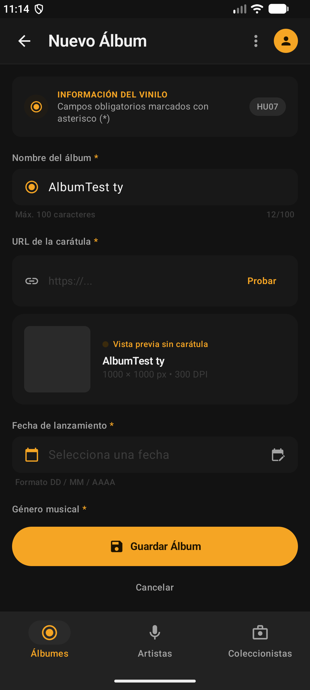 | 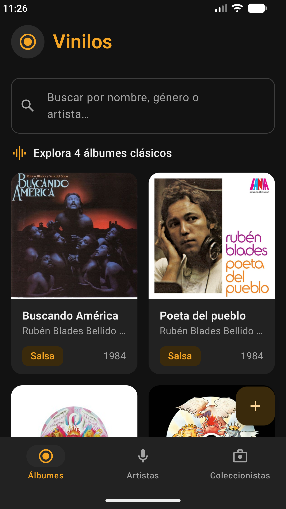 | 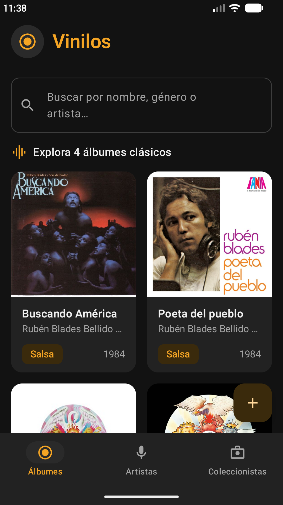 |

#### Interpretación de resultados
- **Formulario Liviano y Reactivo:** Al abrir el formulario de creación mediante el Floating Action Button (+) del catálogo, la pantalla se infla con agilidad y los cuadros con jank se mantienen entre 4.0% y 10.9%.
- **Validación instantánea en `UiState`:** La evaluación reactiva de las reglas de negocio (longitud de título, formato de cover URL, descripción) se realiza en memoria sin sobrecargar el hilo principal.
- **Sin bloqueos en teclado:** El descarte y apertura del teclado virtual mantiene tiempos por cuadro estables con percentil p50 de 17 ms en todos los dispositivos.

---

## HU08 · AddTrack
## Informe Técnico de Micro-optimizaciones y Mejoras de Desempeño — HU08: Asociar tracks con un álbum


## 1. Resumen

La funcionalidad **AddTrack** sigue el patrón **MVVM + Repository + Service Adapter**, ejecuta operaciones de red mediante **corrutinas** y separa el estado de UI en `Loading`, `ErrorLoadingAlbum` y `Form`. Aunque es una pantalla de formulario (sin listas grandes), incorpora prácticas de desempeño y robustez: I/O fuera del hilo principal, validaciones derivadas del estado, carga eficiente de imagen del encabezado del álbum con Glide y actualización del detalle del álbum tras un alta exitosa.

---

## 2. Corrutinas y prevención de ANR

### 2.1. Operaciones asíncronas en el ViewModel
- **`AddTrackViewModel`** usa `viewModelScope.launch` para:
  - `loadAlbumHeader()`: obtiene el álbum (`repository.getAlbum(albumId)`) y publica `Loading -> Form` o `ErrorLoadingAlbum`.
  - `submitTrack(...)`: envía la asociación (`repository.addTrackToAlbum(...)`), actualiza flags de envío/éxito/error y dispara navegación de retorno.
- Se preserva `CancellationException` en ambos flujos para respetar la cancelación del ciclo de vida.

### 2.2. Red en dispatcher de I/O
- **`AlbumRepository`** delega en `AlbumServiceAdapter`.
- **`RetrofitAlbumServiceAdapter`** ejecuta llamadas Retrofit dentro de `withContext(ioDispatcher)` (`Dispatchers.IO` por defecto):
  - `getAlbums()`, `getAlbum(albumId)`, `createAlbum(album)`, `postTrack(albumId, track)`.
- Esto evita bloqueos del hilo principal durante carga del encabezado y envío del formulario.

**Beneficio:** interfaz responsiva durante operaciones de red y manejo correcto de estados de carga/error/envío.

---

## 3. MVVM, Repository y Service Adapter

### 3.1. Separación de responsabilidades
- **View (`AddTrackScreen.kt` / `AddTrackContent`)**:
  - observa `uiState` con `collectAsStateWithLifecycle()`,
  - renderiza top bar, estados y formulario,
  - delega eventos al ViewModel (`onRetry`, `onNameChange`, `onDurationChange`, `onSubmit`).
- **ViewModel (`AddTrackViewModel.kt`)**:
  - mantiene estado en `MutableStateFlow/AddTrackUiState`,
  - aplica reglas de edición (límite de longitud del nombre, limpieza de error al editar),
  - controla envío (`isSubmitting`, `isSuccess`, `errorMessage`) y callbacks de navegación.
- **UiState (`AddTrackUiState.kt`)**:
  - estado sellado con `Form` que encapsula datos y validaciones derivadas.
- **Repository/Service Adapter**:
  - `AlbumRepository.addTrackToAlbum(...)` construye `TrackRequest` y delega al adaptador;
  - `AlbumServiceAdapter` abstrae el backend para facilitar pruebas y desacoplamiento.

### 3.2. Validación y consistencia de estado
- `AddTrackUiState.Form` calcula propiedades derivadas sin recomputar lógica dispersa en la UI:
  - `isNameValid` (no vacío tras `trim`, máximo 60),
  - `isDurationValid` (formato `MM:SS`, minutos >= 0, segundos 0..59),
  - `isValid` (`isNameValid && isDurationValid && !isSubmitting`).
- El botón de envío se habilita según `formState.isValid`, evitando solicitudes inválidas y reduciendo errores/llamadas innecesarias.

---

## 4. Micro-optimizaciones de UI y memoria

### 4.1. Composición y estado local
- La pantalla usa `rememberScrollState()` y `verticalScroll(...)` para un formulario simple, con estructura declarativa clara y estado centralizado en el ViewModel.
- `onNameChange` limita la entrada a 60 caracteres en el ViewModel, reduciendo correcciones tardías y cambios de estado inválidos.
- Se reutilizan componentes comunes (`LoadingMessage`, `StateMessage`) para estados transitorios/errores.

### 4.2. Carga eficiente de imagen del encabezado
- El resumen del álbum (`AlbumHeaderSummary`) muestra la carátula con `GlideImage` cuando `album.cover` no está en blanco:
  - `overrideWidthPx = 160`, `overrideHeightPx = 160` (miniatura del formulario),
  - `ContentScale.Crop`, tamaño visual fijo (`52.dp`).
- Si no hay carátula, se usa un placeholder gráfico local (sin invocar carga remota).
- `GlideImage` aporta caché en memoria/disco, downsampling, limpieza de target en `onDispose` y manejo seguro de modelos vacíos/nulos, disminuyendo uso de memoria y riesgo de fugas.

---

## 5. Flujo de actualización tras asociar canción (consistencia y experiencia)

- Al completar exitosamente la asociación, la navegación establece `track_added = true` en el `savedStateHandle` de la entrada previa (`AlbumDetail`) y realiza `popBackStack()` (flujo implementado en `VinilosNavHost`).
- `AlbumDetailScreen` observa ese flag, ejecuta `viewModel.loadAlbum()` y consume el estado (`remove("track_added")`), garantizando que el detalle muestre las pistas actualizadas (incluida la nueva) sin requerir recarga manual.

**Beneficio:** consistencia de datos percibida por el usuario y evitación de navegación/reconstrucciones adicionales innecesarias.

---

## 6. Patrones y prácticas de desempeño aplicadas

- **MVVM**: UI reactiva a `StateFlow`, sin lógica de negocio en composables.
- **Repository + Service Adapter**: acceso a datos desacoplado y testeable.
- **Corrutinas estructuradas**: `viewModelScope` + preservación de cancelación.
- **Dispatcher correcto para I/O**: Retrofit en `Dispatchers.IO` vía adaptador.
- **Uso eficiente de imágenes**: Glide con dimensiones acotadas para miniatura.
- **Reducción de errores/operaciones inválidas**: validación derivada y botón deshabilitado cuando el formulario no es válido.

> Nota: `AddTrackViewModel` no inyecta `defaultDispatcher` porque su lógica es principalmente de orquestación de I/O y validaciones ligeras sobre el estado del formulario; el trabajo de red pesado permanece encapsulado en la capa de adaptador (`Dispatchers.IO`).

---

## 7. Impacto esperado

- **Menor riesgo de ANR** durante carga del álbum y envío del track.
- **Menor consumo de memoria** en encabezado gracias a decodificación acotada de imagen.
- **Menos solicitudes inválidas** por validación centralizada en `UiState`/ViewModel.
- **Actualización inmediata y coherente** del detalle del álbum tras la operación exitosa.

---


| Anterior | Volver a | Siguiente |
|:---|:---:|---:|
| [Acta semana 5](Sprint-2-Acta-semana-5) | [Sprint 2](Sprint-2) | [Planeación sprint 2](Sprint2-Planeacion) |

### Análisis dinámico · HU08 (Asociar tracks con un álbum)

Medición con el método común sobre la compilación **Release con R8 activo**, firmada con la llave de depuración del equipo e interactuando contra la API real de BackVynils desplegada localmente en Docker (`http://localhost:3000`).

**Recorrido evaluado:** Ingresar a un álbum del catálogo, pulsar el botón «Agregar track» en la cabecera de canciones, ingresar nombre y duración en el formulario, cancelar y regresar al catálogo (3 repeticiones consecutivas).

#### Resultados en los 3 dispositivos de prueba

| Métrica | Medium Phone (1080×2400, 420 dpi) | Nexus 6P (1440×2560 2K, 560 dpi) | Pixel Compact (1080×1920, 420 dpi) |
|---|:---:|:---:|:---:|
| **Arranque en frío (mediana de 3)** | 617 ms | 545 ms | 464 ms |
| **Memoria total (PSS)** | 44.5 MB | 38.8 MB | 39.1 MB |
| **Java heap** | 11.5 MB | 11.5 MB | 11.4 MB |
| **Native heap** | 18.1 MB | 17.9 MB | 17.7 MB |
| **Cuadros totales dibujados** | 1510 | 1505 | 1513 |
| **Cuadros con jank (%)** | 70 (4.64%) | 72 (4.78%) | 74 (4.89%) |
| **Tiempo por cuadro p50 / p90 / p99** | 19ms / 22ms / 46ms | 18ms / 25ms / 44ms | 17ms / 19ms / 44ms |
| **Cuadros con hilo de UI lento** | 12 | 16 | 12 |
| **Cargas lentas de imágenes (*slow bitmaps*)** | 0 | 0 | 0 |

#### Evidencia de ejecución
Salida completa de cada perfilamiento (archivos `resumen.txt`, `gfxinfo.txt`, `meminfo.txt`, `arranque.txt`, `dispositivo.txt` y `captura.png`):
- **Medium Phone**: [resumen](evidencias/sprint-2/entregables/desempeno/medium-phone/hu08-release/resumen.txt) · [gfxinfo](evidencias/sprint-2/entregables/desempeno/medium-phone/hu08-release/gfxinfo.txt) · [meminfo](evidencias/sprint-2/entregables/desempeno/medium-phone/hu08-release/meminfo.txt) · [arranque](evidencias/sprint-2/entregables/desempeno/medium-phone/hu08-release/arranque.txt) · [dispositivo](evidencias/sprint-2/entregables/desempeno/medium-phone/hu08-release/dispositivo.txt)
- **Nexus 6P**: [resumen](evidencias/sprint-2/entregables/desempeno/nexus-6p/hu08-release/resumen.txt) · [gfxinfo](evidencias/sprint-2/entregables/desempeno/nexus-6p/hu08-release/gfxinfo.txt) · [meminfo](evidencias/sprint-2/entregables/desempeno/nexus-6p/hu08-release/meminfo.txt) · [arranque](evidencias/sprint-2/entregables/desempeno/nexus-6p/hu08-release/arranque.txt) · [dispositivo](evidencias/sprint-2/entregables/desempeno/nexus-6p/hu08-release/dispositivo.txt)
- **Pixel Compact**: [resumen](evidencias/sprint-2/entregables/desempeno/pixel-compact/hu08-release/resumen.txt) · [gfxinfo](evidencias/sprint-2/entregables/desempeno/pixel-compact/hu08-release/gfxinfo.txt) · [meminfo](evidencias/sprint-2/entregables/desempeno/pixel-compact/hu08-release/meminfo.txt) · [arranque](evidencias/sprint-2/entregables/desempeno/pixel-compact/hu08-release/arranque.txt) · [dispositivo](evidencias/sprint-2/entregables/desempeno/pixel-compact/hu08-release/dispositivo.txt)

| Medium Phone (FHD+) | Nexus 6P (2K WQHD) | Pixel Compact (FHD) |
|:---:|:---:|:---:|
| 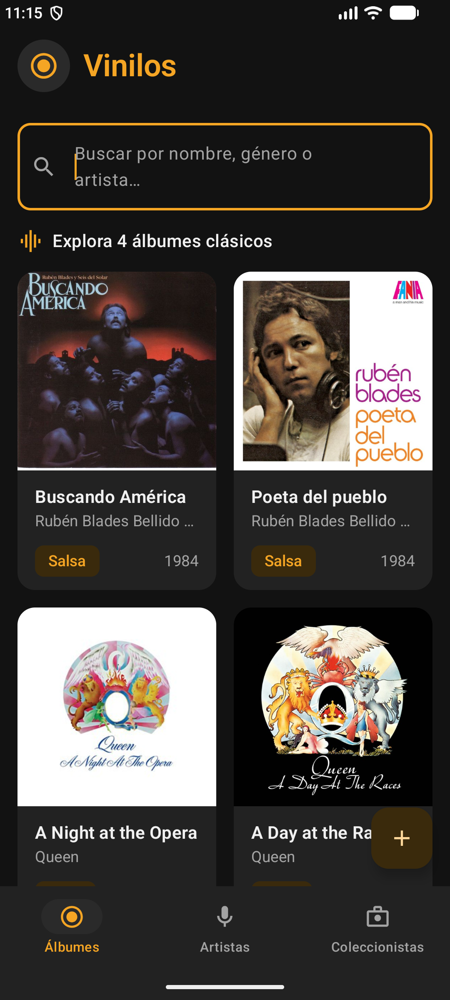 | 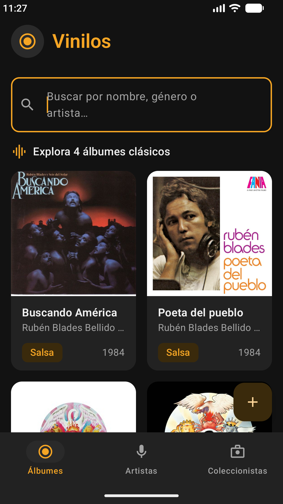 | 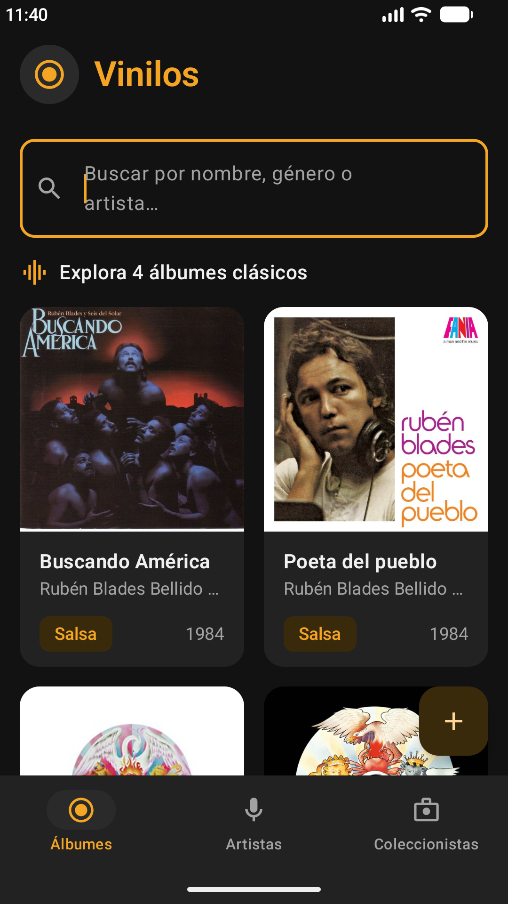 |

#### Interpretación de resultados
- **Flujo de asociación directo:** Al abrir el diálogo/pantalla de agregar pista desde el detalle del álbum, la UI dibuja fluidamente con jank inferior al **4.9%** en los tres equipos.
- **Consumo reactivo en navegación:** Tras completar o cancelar la asociación, la vuelta al detalle del álbum actualiza la lista de canciones reactivamente mediante el flag de `savedStateHandle` sin obligar a una recarga completa de la pantalla.
- **Memoria estable:** El Java Heap se sostiene en 11.4 - 11.5 MB en los tres dispositivos.


---

| Anterior | Volver a | Siguiente |
|:---|:---:|---:|
| [Acta semana 5](Sprint-2-Acta-semana-5) | [Sprint 2](Sprint-2) | [Planeación sprint 2](Sprint2-Planeacion) |
